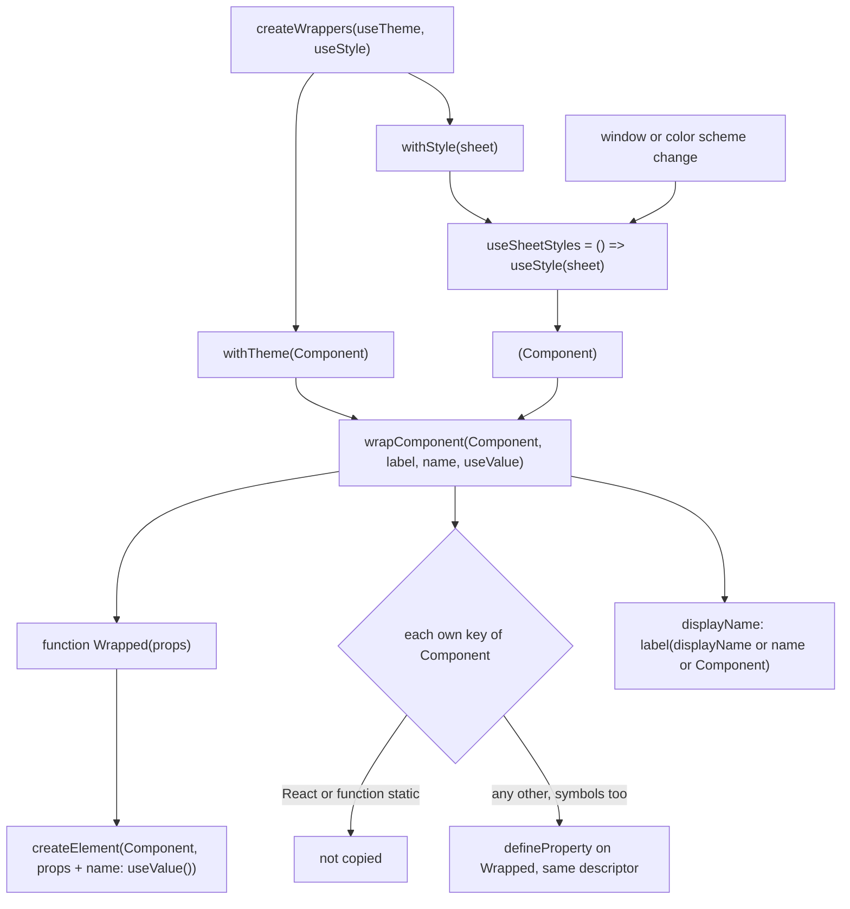

# createWrappers.ts

The same file as `packages/react/src/createWrappers.ts`, kept in this binding because it does not depend on
the React binding (and the core knows no framework). `createStyle.ts` (`bindHolder`) and `defaultStyle.ts`
call it with their `useTheme` and `useStyle`.

## What it does

`createWrappers(useTheme, useStyle)` returns `withTheme` and `withStyle`:

- `withTheme(Component)` is a function component that renders `Component` with every prop it is given and
  `theme` set to `useTheme()`: the real theme of the nearest provider, lengths as numbers.
- `withStyle(sheet)(Component)` is the same with `styles` set to `useStyle(sheet)`: the registered style
  objects of the sheet.

## Why it exists

A class component cannot call a hook. The wrapper calls it for the component, so a class component gets what
`useTheme` and `useStyle` give, and follows what they follow: `useStyle` subscribes to the window and the
system color scheme for the media and `whenScheme()` keys of the sheet, and reads the providers for its
`when()` keys, so the wrapper renders the component again on a rotation or a change of the scheme.

## The logic

## What it guarantees

- `theme` is the object `useTheme()` returns and `styles` the entries `useStyle(sheet)` returns, the same
  objects, under nested providers and after a resize and a change of the system color scheme
  (`createWrappers.test.tsx`).
- `ref` is passed on as a prop, the wrapper's value replaces a `theme` or `styles` given to it, the statics
  that are not React's own are copied, and the display name is `withTheme(Name)` or `withStyle(Name)`: see
  the sidecar of the React binding's file, whose rules this file keeps word for word.

## Decisions

- One file per binding, the same code: a change to one is made to the other in the same commit.

## Limits

- The window and the color scheme were changed through the stand-ins of the tests, not on a device.
