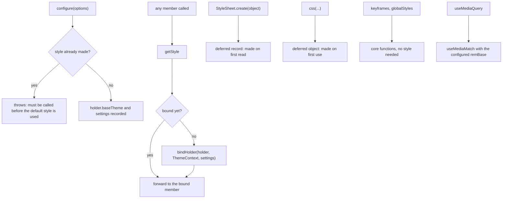

# defaultStyle.ts

## What it does

`createDefaultStyle()` returns the members an app imports from the package root (`configure`, `styled`,
`StyleSheet`, `useStyle`, `withStyle`, `useTheme`, `withTheme`, `ThemeProvider`, `ThemeScope`, `useThemeClass`, `useMediaQuery`,
`ThemeContext`, `apply`, `css`, `when`, `whenScheme`, `themeClass`, `keyframes`, `globalStyles`, `Global`).
Each one forwards to a style that is made on first use.

## Why it exists

An app imports `styled` from the package and calls `configure({ theme, remBase, lengthKeys, animated })`, possibly
after other modules already created sheets and styled components. The default style therefore cannot bind a
holder when it is created: it binds on the first real use and, until then, only records `configure`'s
options. `index.ts` is the only caller and pulls the members out of it.

## The logic

## The data

`DefaultStyleOptions` extends `StyleOptions<Theme>` with an optional `theme`. The state is a holder
`{ baseTheme }`, the last `settings`, the bound style (or none) and one `ThemeContext` created at once, so
it can be exported before the style exists.

## What it guarantees

- `configure` throws once any member made the style; the message is fixed.
- A module may create an object sheet or call `css()` before `configure`: both are deferred until read.
- `keyframes` and `globalStyles` are the core's, so they work before `configure`.
- `ThemeContext` is the same object before and after the style is made.
- `useMediaQuery` reads `remBase` from the settings, or the default 16.

## Decisions

- Lazy binding rather than a required `configure` call: the order of module loading is the app's.
- A function sheet is bound at once (`StyleSheet.create(fn)` calls `getStyle()`), and so is `styled(tag)`:
  both end the `configure` window; an object sheet and `css()` do not.
- `ThemeProvider`, `Global` and `ThemeScope` call the bound member as a function, not as a component, so
  they add no wrapper.

## Limits

- After the first use the options cannot change; there is no reset. `animated` is one of them: an app that
  wants animations gives it to `configure` before any member is used.
