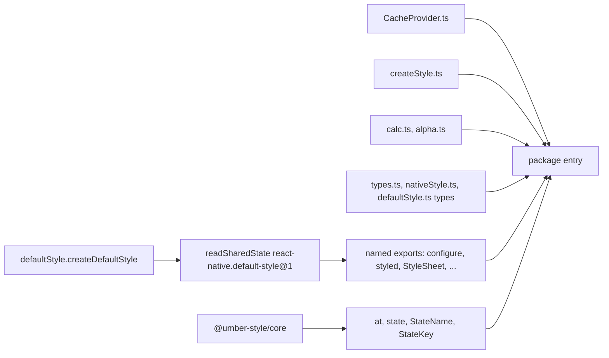

# index.ts

## What it does

The entry of `@umber-style/react-native`. It makes the default style once, exports its members by name
(`configure`, `styled`, `StyleSheet`, `useStyle`, `withStyle`, `ThemeProvider`, `useTheme`, `withTheme`, `css`, `when`, `whenScheme`, and
the rest), and re-exports `at` and `state` (with the types `StateName` and `StateKey`) from the core, `CacheProvider`, `createStyle`, the calc helpers, `alpha`, and
the types.

## Why it exists

The package's public API is this one file. The default style is taken with `readSharedState` under the name
`react-native.default-style@1`, so that two copies of the binding in one program share one default style: a
component of one copy then reads the provider of the other (the comment says so). The umbrella package
re-exports this entry as `umber-style/react-native`.

## The logic

## What it guarantees

- One default style for the whole program, however many copies of the package are loaded.
- Creating it does not touch the platform or read a theme: `createDefaultStyle` makes the style lazily.
- `export *` of `defaultStyle`, `nativeStyle` and `types` adds only what those files export.
- `NativeLength`, `NativeTheme`, `MediaQueryOptions`, `StateName` and `StateKey` are exported as types only.
- `state` is the core's function, the same object as in every other entry, so a style made with any of them
  holds the same key.
- `setNonceSource` is the core's, exported so that every binding has the name: React Native has no style elements and no server components, and nothing here reads it.

## Decisions

- The members are destructured from one object, so a name exists once and has one definition.
- `alpha` and the calc helpers are the package's own here, while the Vue entry re-exports the core's.
  The reason is not recorded in this file.
