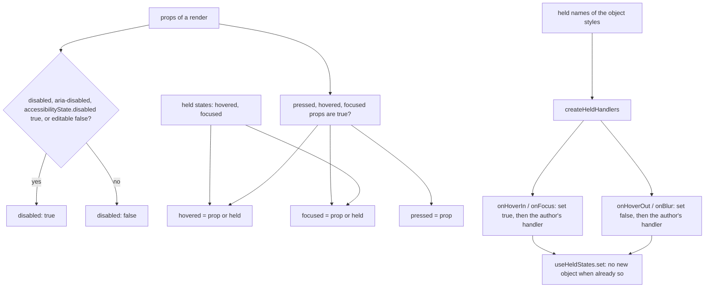

# interaction.ts

## What it does

What a styled component knows of its own state, for the `state()` keys: `readInteraction(props, held?)`
reads `disabled`, `pressed`, `hovered` and `focused` from the props and the states the component keeps;
`useHeldStates()` keeps hover and focus as React state; `createHeldHandlers(names, props, held)` makes the
`onHoverIn`/`onHoverOut` and `onFocus`/`onBlur` handlers that set them and then call the author's own;
`isStateProp` and `isHeldName` answer which names are the state props and which states are kept.

## Why it exists

React Native has no cascade to decide `:active` or `:hover`. A component tells its state through its props
(`disabled`, `aria-disabled`, `accessibilityState`, `editable`), through `Pressable`'s style callback
(`pressed`, handled in `styled.ts`), or through events (`onHoverIn`, `onFocus`). This file is the part of
`styled.ts` that reads props and keeps event state, so that the component shapes stay readable. Only
`styled.ts` imports it.

## The logic

## The data

`InteractionState` (from `conditions.ts`) is `{ hovered?, pressed?, focused?, disabled? }`. `HeldStates` is
`{ states, set }`: the hover and focus kept now, and the setter the handlers call. `HELD_EVENTS` maps
`hovered` to `['onHoverIn', 'onHoverOut']` and `focused` to `['onFocus', 'onBlur']`, the names `Pressable`,
`TextInput` and the touchables take.

## What it guarantees

- `readInteraction` gives every one of the four states, true or false; it reads `true` only from a boolean
  `true` (and `editable` only from `false`), never from a truthy string.
- A handler sets its state, then calls the handler of the same name in the props, when it is a function,
  with the event; the author's handler is never lost and is called once.
- `set` with the value already held returns the same state object, so React does not render again.
- Only the states named are given handlers: a component whose object styles name `focused` alone gets
  `onFocus` and `onBlur`, not the hover handlers.

## Decisions

- `editable={false}` counts as disabled: on a `TextInput` it is the platform's way to say the field takes no
  input, and it does not set the accessibility state (issue #42, the investigation of React Native 0.88.1),
  so `aria-disabled` alone would miss it. On another component `editable` means nothing and is not given.
- `pressed` is not kept from `onPressIn`/`onPressOut`: a `Pressable` reports it through its style callback,
  and for another component the author passes the prop. Keeping it from events would need a hook in every
  pressable, which is what the function `style` avoids.
- Hover and focus are kept in one state object, so a component that keeps both has one hook.

## Limits

- A state kept from events starts false: a component made focused (autoFocus) before its first `onFocus`
  reaches the binding is not seen as focused until the next event.
- The events say nothing about how focus arrived: `focused` is any focus, keyboard or touch.
