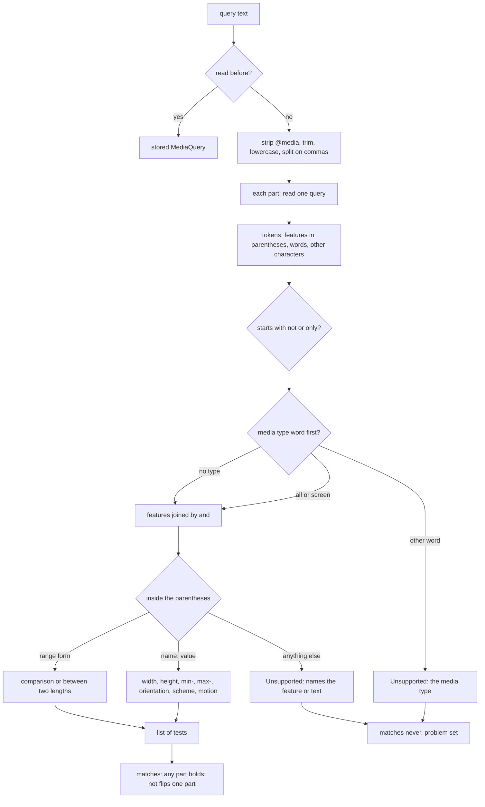

# mediaQuery.ts

## What it does

Reads a media query text once and gives back a `MediaQuery`: a `matches(state, remBase)` test and, when the
text holds something the binding cannot evaluate, a `problem` string that names it. `isMediaKey(key)` says
whether a style key is a media query (`@media` followed by white space or a parenthesis).

## Why it exists

React Native has no media queries, yet a shared style may carry `@media (min-width: 600px)` keys and
`useMediaQuery('...')` takes the same text. This file is the parser and evaluator for a supported subset,
against a `WindowState` (width, height, color scheme, reduced motion). `toNativeStyle.ts` evaluates keys with
it, `windowState.ts` builds the render keys and the hook with it, and `warnStyle.ts` asks it for the
`problem` of a key that is dropped.

## The logic

## The data

`WindowState` is `{ width, height, colorScheme, isReducedMotion }`. A part reads to a `Test` (a function of
the state and `remBase`) or an `Unsupported` object with its `problem` text, such as `the media feature "hover"`.
From the tests, `(min-width: 600px)` holds for widths 600 to 1000 of the sampled list, and
`(width > 600px)` for 700 to 1000.

## What it guarantees

- Each distinct text is read once (a module-level `Map`) and the same `MediaQuery` returns after.
- A query with any unsupported part never matches and has a `problem`; nothing throws.
- Lengths: no unit and `px` are pixels; `rem` and `em` are `remBase` times the number; other units are
  `Unsupported`.
- Orientation is portrait when height is at least width. A color scheme other than `dark` counts as light.
- A media type alone matches, unless negated.
- The tokenizer does not use a pattern that backtracks on white space (the comment on `RANGE` says why).
- No browser or platform global is touched; the state comes from the caller.

## Decisions

- A subset by design: `width`, `height` with `min-` and `max-`, the range forms, `orientation`,
  `prefers-color-scheme`, `prefers-reduced-motion`, joined by `and`, comma lists, `not` and `only`, types
  `all` and `screen`. The doc comment on `readMediaQuery` lists it.
- A range with two lengths needs both operators to point the same way; a mixed pair is `Unsupported`.

## Limits

- `hover`, `pointer`, `aspect-ratio`, `or`, a media type such as `print`, and units such as `vw` are not
  evaluated; they give a `problem` (`mediaQuery.test.ts`, `warnStyle.ts`).
- The cache of read queries is never emptied.
