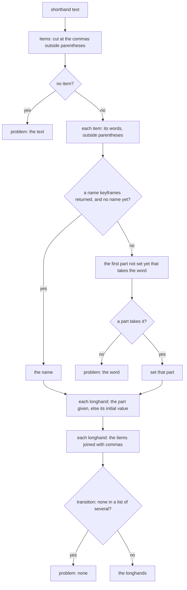

# motionShorthand.ts

## What it does

`expandAnimation(text, isName)` and `expandTransition(text)` read the `animation` and `transition` shorthands
of CSS and give each longhand as a comma list, one item for each animation or transition of the shorthand;
or, for a part that cannot be read, that part. It also holds the keyword sets of the longhands
(`DIRECTIONS`, `FILL_MODES`, `PLAY_STATES`, `BEHAVIORS`), which `animatedDriver.ts` checks the longhands
against.

## Why it exists

A shared style writes `animation: pulse-1x 1.5s ease-in-out infinite`, the form the web reads. The animation
library runs no `animation` shorthand and reads its own `transition` shorthand in a way that throws on what
it cannot read, so the entry expands both into longhands, as CSS does, before it reads the values. Only
`animatedDriver.ts` imports this file.

## The logic

The parts of an `animation` item are tried in this order: duration (a time), delay (a time), easing,
iteration count (`infinite` or a number), direction, fill mode, play state, and the name, which takes any
word. The parts of a `transition` item: duration, delay, easing, behavior, and the property, which takes any
word.

## The data

`Expansion` is `{ longhands }` (a record from each longhand to its comma list) or `{ problem }` (the word that
no part took). `INITIAL` holds the initial value of each longhand: `none`, `0s`, `ease`, `0s`, `1`,
`normal`, `none`, `running`; `all`, `0s`, `ease`, `0s`, `normal`.

## What it guarantees

- Every longhand is set, those not given to their initial values, as CSS resets them: a shorthand written
  after a longhand of its own in one rule wins over it.
- The first time is the duration and the second the delay, as CSS reads them.
- A keyword of a part that is set already is read as the name (`1s none none`: fill mode `none`, name
  `none`), as CSS reads it; a name that `keyframes` returned is the name before anything else.
- A word no part takes makes the whole shorthand unreadable, as the web drops a declaration that is not
  valid; so does `none` among several transitions, and an empty text.

## Decisions

- Each longhand comes back as text, a comma list, so that `animatedDriver.ts` reads a longhand the same way
  whether it was written as such or came from a shorthand.
- The values of a part are only recognised here, not checked: a negative count or an easing it cannot read
  is reported when the longhand is read.

## Limits

- A name of an animation that is a keyword of a part not set yet is read as that part, as CSS reads it: a
  name that `keyframes` returned never is (it ends with a hash), but a name written by hand (`ease`) would be.
- `animation-timeline` and the other parts of the newer levels of CSS are not read: a shorthand that has one
  is dropped.
