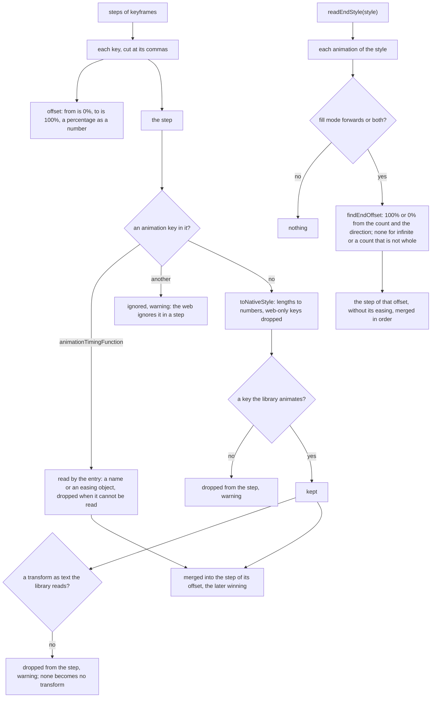

# motionSteps.ts

## What it does

`translateSteps(steps, settings)` turns the steps of an animation, as `keyframes` was given them, into the
steps the animation library takes. `findEndOffset(count, direction)` and `readEndStyle(style, readSteps)` say
where a finished animation leaves a view, for reduced motion. `ANIMATED_KEYS` is the set of style properties
the library animates on React Native.

## Why it exists

The steps of a shared animation are written for the web: lengths in `px` or `rem`, keys the platform does
not have, an easing per step written as text. The library takes native styles keyed by offset, and drops a
key it does not animate without a word. This file makes the steps native, as a style is made native, and
says in development what is dropped. `animatedDriver.ts` is its only importer.

## The logic

## The data

`LibrarySteps` is a record from an offset (`'0%'` to `'100%'`) to a native style. `StepSettings` is `{ remBase,
name, readEasing }`: the base of `rem`, the component for the warnings, and the entry's reading of an easing.
`ANIMATED_KEYS` is the list of the keys of `STYLE_PROPERTIES_CONFIG` (`src/common/style/config.ts` of
react-native-reanimated 4.8.0) that the library does not set to `false`.

## What it guarantees

- A step is turned into a native style as a style is (`toNativeStyle`, with no condition and no motion):
  `'8px'` is `8`, `'1rem'` is `remBase`, a selector or a custom property is dropped with its warning.
- A key the library does not animate is dropped from the step with a development warning that names it; the
  library would drop it without one (`src/common/style/createPropsBuilder.ts` of 4.8.0, 89-95).
- The steps of one offset are merged, the later winning, as `keyframes` of the core merges them.
- A transform written as text in a step reaches the library only when the library reads every function of
  it (`readTransform` of `motionText.ts`): `none` becomes no transform (`[]`), which 4.7 does not read, and
  other text is dropped with a development warning, because 4.7 throws for it and 4.8 ignores it.
- `findEndOffset` follows the cycles: a normal animation ends at 100%, a reversed one at 0%, an alternating
  one where its last cycle ends (`alternate` with an even count ends at 0%), a count of 0 where it starts.

## Decisions

- An end step is merged only for a finite animation that fills forwards: without `forwards` or `both` the
  web shows the view's own style after the animation, and an infinite animation has no end.
- The list of keys is copied from the library rather than read from it: its configuration is not part of
  its public API. A key it animates on one platform only (`shadowOffset`, `shadowOpacity` and `shadowRadius`
  not on Android; `elevation` and `overlayColor` only there) is in the list.

## Limits

- The list follows 4.8.0; a key the library adds or drops later is not followed until the list is. 4.7
  does not animate five keys of it (`borderCurve`, `experimental_backgroundImage`, `verticalAlign`,
  `writingDirection`, `objectFit`) and drops them from a step without a word.
