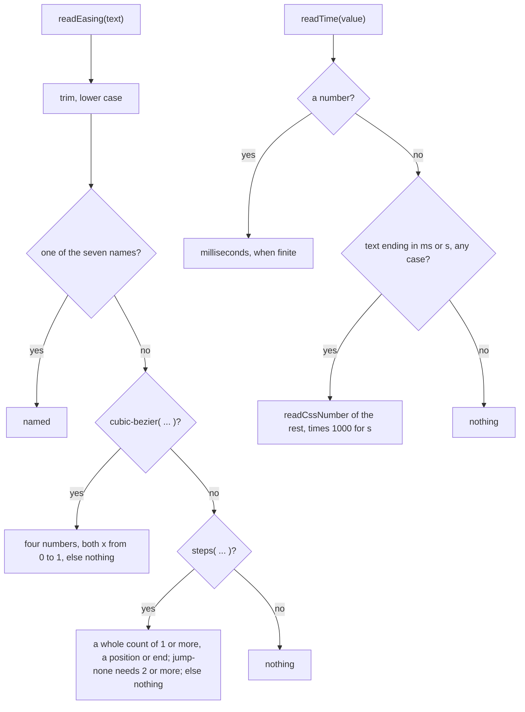

# motionText.ts

## What it does

Readers of the text of animation and transition values, with no regular expression that can backtrack:
`splitList` and `splitWords` cut a value at its commas or its white space outside parentheses;
`readCssNumber` reads a number as CSS writes one; `readTime` reads a time into milliseconds; `readEasing`
reads a named easing, `cubic-bezier(...)` or `steps(...)`; `isEasingWord` tells a word that looks like an
easing; `readTransform` tells a transform written as text that the animation library reads; `toCamelCase`
names a CSS property as the platform does.

## Why it exists

The web writes `cubic-bezier(0.25, 0.1, 0.25, 1)` and `steps(4, jump-start)` as text, and the animation
library throws for that text in a longhand. The repository's analyser rejects regular expressions that can
backtrack, so the parsers are written by hand. `motionShorthand.ts` and `animatedDriver.ts` import this file.

## The logic

## The data

`EasingReading` is `{ kind: 'named', name }`, `{ kind: 'cubic-bezier', points }` or `{ kind: 'steps',
count, position }`. The named easings are `linear`, `ease`, `ease-in`, `ease-out`, `ease-in-out`,
`step-start` and `step-end`, the seven of CSS and of the library (`src/css/constants/settings.ts` of
react-native-reanimated 4.8.0). The positions of `steps()` are `jump-start`, `jump-end`, `jump-none`,
`jump-both`, `start` and `end`.

## What it guarantees

- A reading is valid by the rules of CSS: what CSS rejects (`cubic-bezier` with an x outside 0 to 1, a count
  of steps that is not whole or below 1, `jump-none` with one step, a position it does not know) gives
  nothing, so the entry drops it as the web drops a value that is not valid.
- `readCssNumber` takes only the characters of a CSS number, so `0x10` and `Infinity` are not numbers.
- Each function is linear in the length of its text.
- `readTransform` accepts what the parser of transforms of the library reads, the same in 4.7.1 and 4.8.0
  (`src/common/style/processors/transform.ts`): `translate`, `translateX`, `translateY` with numbers (as
  `parseFloat` reads them, so `8px` is 8) or percentages, `scale`, `scaleX`, `scaleY` and `perspective`
  with numbers, `rotate`, `rotateX`, `rotateY`, `rotateZ`, `skew`, `skewX`, `skewY` with angles in `deg` or
  `rad` or `0`, `matrix` with 6 or 16 numbers, each with the number of arguments it takes; and it requires
  the closing parenthesis, as CSS does. `none` gives no transform (`[]`).

## Decisions

- `linear(...)` is recognised as an easing word by `isEasingWord` (so a shorthand reads it as the easing
  part) and not read by `readEasing`: the entry drops it with a warning.
- A time is read in any case (`300MS`), as CSS reads a unit.

## Limits

- `readCssNumber` checks the characters and that the number is finite; a text such as `1-` is caught by
  `Number`, not by a grammar of its own.
