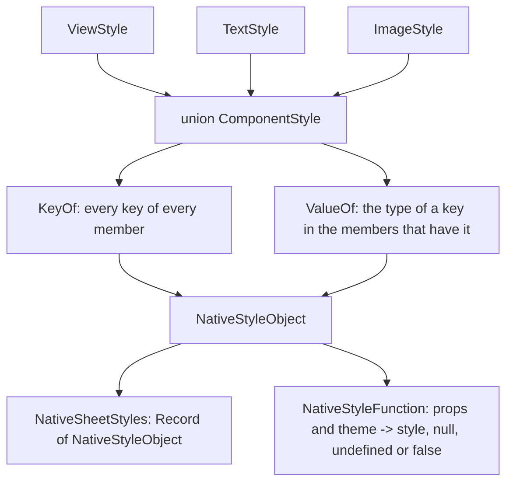

# nativeStyle.ts

## What it does

Types only. It defines the style object of this binding (`NativeStyleObject`) and the types built from it:
sheets (`NativeSheetStyles`, `NativeObjectSheet`, `NativeSheetInput`) and style functions
(`NativeStyleFunction`, `NativeStyleResult`, `NativeStyleInput`). It has no run-time code.

## Why it exists

A native style is the union of the platform's view, text and image styles. `NativeStyleObject` takes every
key of that union, each with the value type the platform gives it, so a key the platform does not have is a
compile error in an object literal. These types are used by `createStyle.ts`, `styled.ts`, `toNativeStyle.ts`,
`types.ts`, and `index.ts` re-exports the file. It imports only types from `react-native`.

## The logic

## The data

`NativeStyleObject` is `{ [K in KeyOf<ComponentStyle>]?: ValueOf<ComponentStyle, K> }`: every key optional,
nothing nested, no `label`. `NativeObjectSheet<K>` is `Record<K, NativeStyleObject> & { call?: never }`.

## What it guarantees

- An unknown key is an error in an object literal.
- `KeyOf` and `ValueOf` distribute over the union, so a key shared by two styles keeps the type of each member
  that has it.
- A function is not taken for an object sheet: `{ call?: never }` makes the compiler try the object form first
  and fail for a function, so overload resolution reaches the function form.

## Decisions

- One union style, not one per component: a style made once may be used on a view, a text or an image.
- The `native` and `web` parts of a shared style, and the condition and media keys, are not keys of this
  type, although `toNativeStyle` reads them at run time. The reason is not recorded in the code.

## Limits

- Nothing here is checked at run time; `toNativeStyle.ts` and `warnStyle.ts` handle values the types cannot
  reject.
