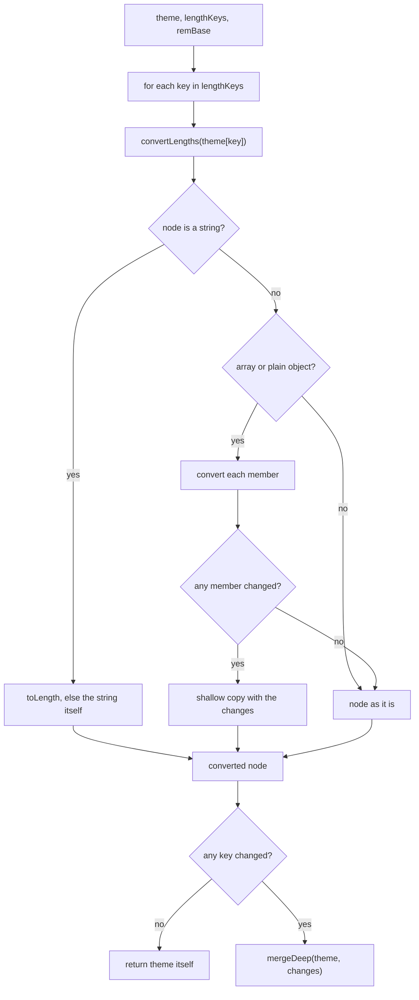

# nativeTheme.ts

## What it does

`toNativeTheme(theme, lengthKeys, remBase)` returns the theme as React Native holds it: under each top-level
key in `lengthKeys`, every string that is a length becomes a number. The file also exports the default key
list (`DEFAULT_LENGTH_KEYS`) and the types that describe the result (`NativeTheme<T>`, `NativeLength<V>`).

## Why it exists

A theme written for the web holds `'8px'` and `'1rem'` under `space`, `sizes` and the like. A native style
needs numbers, and JavaScript that reads `theme.space[2]` needs a number too. Converting the theme once
(rather than every value on every read) gives `useTheme`, style functions and sheet functions real numbers.
`createStyle.ts` calls it (through the `convert` it gives `ThemeValue.tsx`) and takes the default key list;
`types.ts` and `defaultStyle.ts` use the `NativeTheme` type; `index.ts` re-exports `NativeLength` and
`NativeTheme`.

## The logic

## The data

`DEFAULT_LENGTH_KEYS` is `['space', 'sizes', 'radii', 'fontSizes', 'borderWidths']`. In the tests, a theme
with `space: ['8px']` gives `native.space` equal to `[8]`, and a `space` array that also has a property
(`small`) keeps it: `Object.assign([0, 4], { small: 4 })`.

## What it guarantees

- A theme with nothing to convert is returned as the same object (`nativeTheme.test.ts` checks `toBe`).
- Unchanged members keep their identity (`breakpoints`, `palette`, functions under a length key).
- Only plain objects and arrays are walked; a class instance is left alone.
- The input theme is never mutated: a changed node is a copy.
- A string that is not a length (`'50%'`, `'auto'`) stays a string.

## Decisions

- Conversion is keyed by top-level key (`lengthKeys`, an option of `createStyle` and `configure`), not by
  guessing from the value, so only the places an app names are touched. The default list is the web's
  (the doc comment says "the default of the web").
- The type `NativeLength` mirrors the run-time rule: a string type that is `` `${number}px` ``,
  `` `${number}rem` `` or `` `${number}` `` becomes `number`; a plain `string` becomes `string | number`.

## Limits

- Percentages and `calc()`-like strings under a length key are not converted.
- A key outside `lengthKeys` is never converted, even when it holds `'8px'`.
