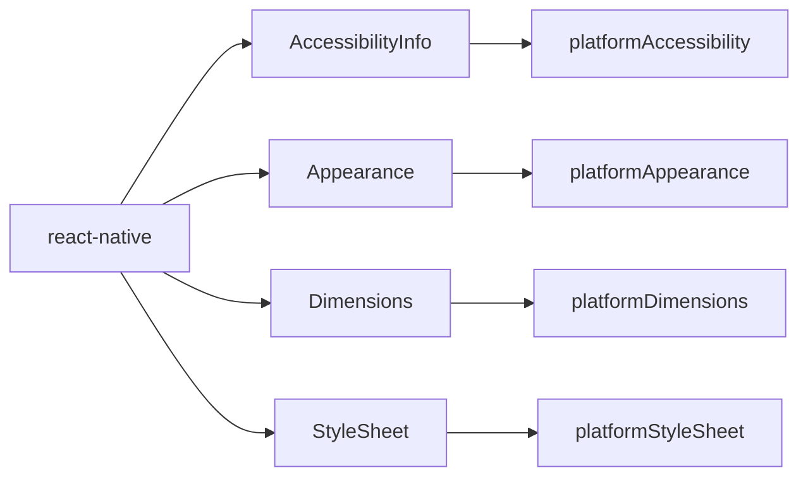

# platform.ts

## What it does

Re-exports four objects of the `react-native` package under the names `platformAccessibility`,
`platformAppearance`, `platformDimensions` and `platformStyleSheet`.

## Why it exists

The binding reads the platform in one place, so a test can stand in for it by resolving `react-native` to a
stand-in (the comment at the top of the file says so). Every other module imports these names, never
`react-native` itself, for values: `conditions.ts`, `windowState.ts`, `styled.ts`, `createStyle.ts` and
`defaultStyle.ts`. `types.ts` imports the type of `platformStyleSheet`. `nativeStyle.ts` imports only
types from `react-native`.

## The logic

## What it guarantees

- It holds no logic and no state; it only renames.
- It is the one value import of `react-native` in `src`, apart from the type imports in `nativeStyle.ts`.

## Decisions

- The `platform` prefix keeps these names apart from the engine's own `StyleSheet`, which spreads
  `platformStyleSheet` and replaces `create`.
