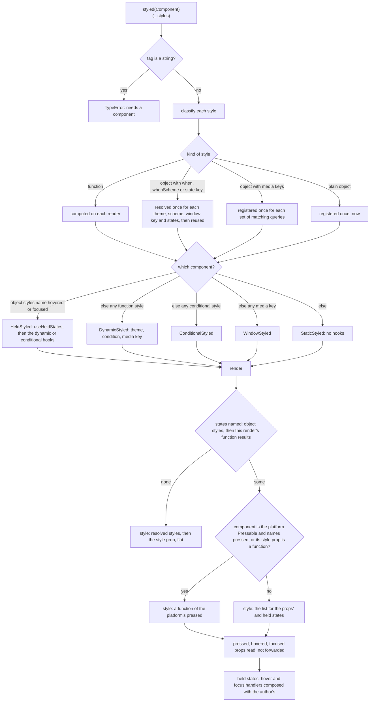
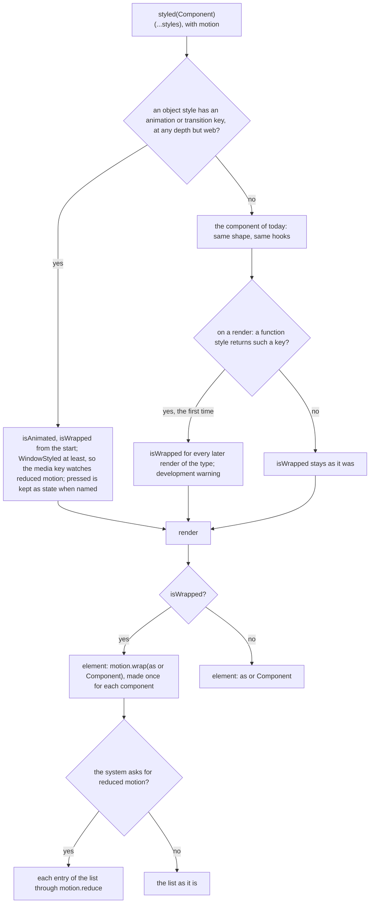

# styled.ts

## What it does

`createStyled(useTheme, useCondition, remBase, motion?)` returns `styled` for React Native. `styled(Component,
options)` takes a component (never a string tag) and the styles, and returns a function component that renders
the component with a `style` array, or, for a `Pressable` whose styles name `pressed`, with a `style` function.
With `motion` (the `animated` option, `types.ts`), a component whose styles have an animation or transition key
renders the animated form of its component (`motion.wrap`) with a `style` array that keeps those keys,
translated by `toNativeStyle`.

## Why it exists

On the web a styled component writes one class. Here it must build a native style array, and the work it does
on each render depends on what its styles need. This file picks the cheapest component for the styles it was
given, so a component with fixed styles reads no context and subscribes to nothing, and a component whose
styles name no state key renders exactly as it did before the state keys. `createStyle.ts` is the only
importer.

## The logic

With `motion`, three more decisions, the first when the component is made and the others on each render:

## The data

`Kind` is `'function' | 'fixed' | 'window' | 'conditional'`. Registered object styles get the names `s0`,
`s1`, ... (the index of the style). `StyleKeys` of each style give the queries, the condition flags and the
states; the queries of object styles come first in the key, so the key of a render starts with theirs, and
the states of object styles come before the states that function styles return. `heldNames` are the
states among the object styles' that are kept from events (`hovered`, `focused`), and `pressed` too when the
object styles animate and name it. `isAnimated` says whether an object style has an animation or transition
key (only with `motion`); `isWrapped`, a variable of the closure of one component type, starts as
`isAnimated` and turns true, for good, the first time a function style returns such a key. The interaction of a
render is `InteractionState` (`interaction.ts`). The conditional object styles as resolved are kept in a
`WeakMap` from the theme of the condition (held weakly; a `Map` without a theme) to a `Map` keyed by the index
of the style, the media key of the render, the color scheme of the provider and the four states as bits: an
entry leaves with its theme object, and a component has at most 16 for each theme, scheme and window key.

## What it guarantees

- The fixed styles are registered once, when the component is made.
- A function style runs on each render with the props and `theme`, and may return nothing or `false`. Its
  media keys and its states are known only after it ran, so they are appended to the key and to the states.
- A component whose styles name no state (this render) gets `style` as one flat list: the resolved styles,
  then the `style` prop last, falsy values removed. The `style` prop wins by order. Its props are forwarded
  as before, `pressed`, `hovered` and `focused` included, and no handler is added.
- A `Pressable` (the platform's object itself, or given as `as`) whose styles name `pressed`, or that gets a
  function `style` prop while its styles name a state, gets `style` as a function of `{ pressed }`: the
  platform calls it on each of its renders, and `Pressable` renders again on a press only because the
  style is a function (`Pressable.js` 248-249 of React Native 0.88.1). A pressable whose styles name no
  state, or `disabled` only, keeps an array, and a press does not render it again (`states.test.tsx`
  counts the renders).
- No other component gets a function: the component is compared by identity with `platformPressable`, so
  a component that cannot read a function `style` is never handed one.
- A function `style` prop is called with the same `{ pressed }` (or the pressed state the props say, when
  no function goes to the platform) and its result comes last.
- Where the styles name a state, `pressed`, `hovered` and `focused` are read from the props and not
  forwarded, unless `shouldForwardProp` returns true for the name; `disabled`, `aria-disabled`,
  `accessibilityState` and `editable` are read and still forwarded.
- `as` replaces the rendered component. `as`, `theme` and `style` are never forwarded; every other prop is,
  unless `shouldForwardProp` refuses it.
- The number and the order of hooks of a component never change between renders: the shape is chosen when
  the component is made, and a state named only by a function style needs no hook (`pressed` comes from the
  platform, `disabled` and the others from the props).
- A component renders again when its set of matching queries changes (or the system scheme, for a
  `whenScheme()` key that no provider decides), not when the width changes inside the same set.
- The development warnings name the component: the `name` option, else `displayName`, else the function name.
- Without `motion` nothing here differs from the binding before the animated entry: `isMovingStyle` answers
  false without reading the style, `isAnimated` and `isWrapped` stay false, and the media key is the same.
- With `motion`, a component whose styles never animate is not wrapped and has the shape and the hooks it
  has without `motion` (`animated.test.tsx` compares the component made with and without the option).
- A component that animates renders `motion.wrap` of its component, the same object for every instance and
  render (`motion` keeps one for each component), and its `useMediaKey` watches reduced motion, so that it
  renders again when the setting changes; while the setting is on, each entry of its list goes through
  `motion.reduce`.
- A component whose object styles animate and name `pressed` keeps the press with `onPressIn` and
  `onPressOut` (`interaction.ts`) and is never given a function `style`: the animated component of the
  library reads the style of its props as a list, and a function there would hide the transition from it.

## Decisions

- No string tags: a native app has no `div`. The error names the tag.
- Four component shapes, and a fifth for kept hover and focus, rather than one with all the hooks, so unused
  features cost nothing.
- Function styles are given the theme `useTheme` reads: the native theme (lengths are numbers).
- How the binding knows a pressable: by identity with the platform's `Pressable`. Rejected: an option of
  `styled` (shared code passes the web's `StyledOptions`, and a wrong option would hand a function to a
  component that cannot read it) and a prop (the same, per element). A wrapper that passes `style` through
  to a `Pressable`, or a styled component of a styled `Pressable`, is not known: style the `Pressable`
  itself, or pass `pressed`.
- Hover and focus in a function style: the hook that keeps them is added only when an OBJECT style names
  them (an empty part is enough), because a function style's keys are known only after it ran, too late to
  add a hook. Rejected: one constant extra hook in every component with a function style (it would change
  the hooks of every existing such component). A function style that names them in a component without the
  hook follows the props of those names alone, with a development warning (`warnAboutUnheldState`).
- A state style is not registered: it changes with the press. It is resolved once for each combination of
  what resolving it reads (`readResolved`): the theme of the condition, the color scheme of the provider,
  the media key of the render (which holds the matching queries, and the system scheme where a scheme key
  reads it) and the states; the style itself is fixed when the component is made, as the fixed styles are.
  The values are those `toNativeStyle` gives (`gives each render the values that resolving it gives`), and
  the same combination gives the same object. In `bench/states-pressables.bench.ts` 48 pressables with
  state keys went from 113 to 60 us (48 without a state key: 46 us), a press from 1.65 us to 441 ns.

- The animation of a component is decided as its states are: from its object styles when it is made, the
  hooks fixed then. A function style that animates is learned only when it ran, so the type turns animated
  then and stays so (an instance mounted before that mounts again once, because its element changes);
  rejected: wrapping every component with a function style (it would change the element of every existing
  one, and the library adds `collapsable: false` to what it wraps), and turning back to the plain component
  when a later render does not animate (every such switch would mount the subtree again). A wrapped
  component whose styles stop animating keeps the wrapper, and the library detaches the animation, as the
  web removes an animation whose name goes away.

## Limits

- A `Pressable` that animates only through a function style, or that is given a function `style` prop
  while it animates, does not report its press to the binding: the press is kept as state only for a
  component whose object styles animate and name `pressed`, and an animated component is never given a
  function `style`. Its `pressed` follows the prop of that name.
- A sheet entry or an object with animation keys given through the `style` prop does not make a component
  animated: the component is wrapped only for its own styles.

- A style that is a function is always run on each render; the result is not cached.
- A function `style` prop on a component whose styles name no state is put in the list as it is, as before
  the state keys; the platform does not call it there.
- `hovered` and `focused` kept from events start false at mount, and a state named first by a function
  style on a later render was not followed before it.
