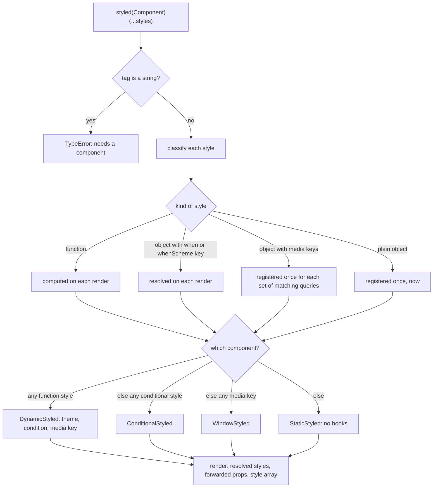

# styled.ts

## What it does

`createStyled(useTheme, useCondition, remBase)` returns `styled` for React Native. `styled(Component, options)`
takes a component (never a string tag) and the styles, and returns a function component that renders the
component with a `style` array.

## Why it exists

On the web a styled component writes one class. Here it must build a native style array, and the work it does
on each render depends on what its styles need. This file picks the cheapest component for the styles it was
given, so a component with fixed styles reads no context and subscribes to nothing. `createStyle.ts` is the
only importer.

## The logic

## The data

`Kind` is `'function' | 'fixed' | 'window' | 'conditional'`. Registered object styles get the names `s0`,
`s1`, ... (the index of the style). `StyleKeys` of each style give the queries and the condition flags; the
queries of object styles come first in the key, so the key of a render starts with theirs.

## What it guarantees

- The fixed styles are registered once, when the component is made.
- A function style runs on each render with the props and `theme`, and may return nothing or `false`. Its
  media keys are known only after it ran, so they are appended to the key.
- The element gets `style` as one flat list: the resolved styles, then the `style` prop last, falsy
  values removed. The `style` prop wins by order.
- `as` replaces the rendered component. `as`, `theme` and `style` are never forwarded; every other prop is,
  unless `shouldForwardProp` refuses it.
- A component renders again when its set of matching queries changes (or the system scheme, for a
  `whenScheme()` key that no provider decides), not when the width changes inside the same set.
- The development warnings name the component: the `name` option, else `displayName`, else the function name.

## Decisions

- No string tags: a native app has no `div`. The error names the tag.
- Four component shapes rather than one with all the hooks, so unused features cost nothing.
- Function styles are given the theme `useTheme` reads: the native theme (lengths are numbers).

## Limits

- A style that is a function is always run on each render; the result is not cached.
