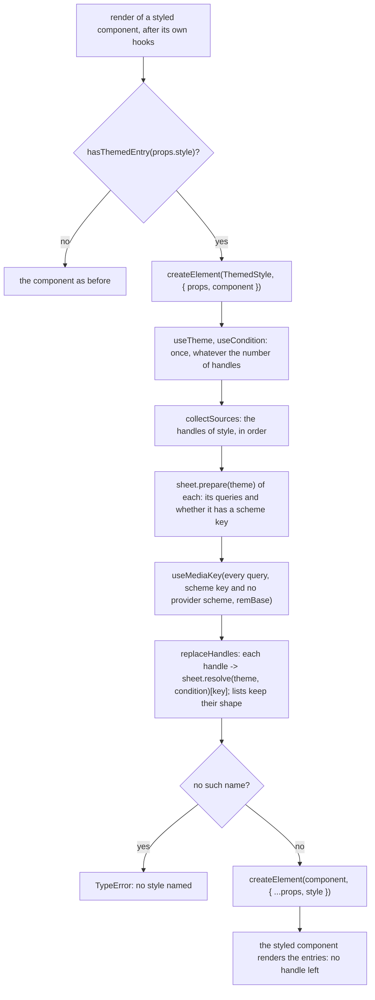

# themedStyle.ts

## What it does

`createThemedStyle(useTheme, useCondition, remBase)` makes `ThemedStyle`, the component that a styled
component renders through when its `style` holds a handle of a sheet made from a function of the theme
(`style={sheet.card}`). `ThemedStyle` reads the theme and the providers once, subscribes to the window and
the color scheme for the media and `whenScheme()` keys of the sheets of those handles, and renders the
styled component again with each handle replaced by its registered entry. `hasThemedEntry(style)` says
whether a `style` holds a handle, at any depth.

## Why it exists

On React Native an entry is a registered style object, and the entry of a sheet with a media, `when()` or
`whenScheme()` key depends on the window and the providers, which only hooks can read (`useStyle` in
`createStyle.ts`). A styled component reads only what its own styles need, many none at all (`styled.md`),
and must not call more hooks when it is given a handle. So the handle is resolved one level down, in a
component of its own, that the styled component renders only when a handle is given (#88, decision 1 of the
owner). A component given no handle is unchanged and pays one check of its `style`. `styled.ts` is the only
importer.

## The logic

## The data

- A handle's source is `{ sheet, key }` (`themedEntry.ts` of the core); the sheet is the one
  `StyleSheet.create` made, with `prepare(theme)` (its registration for that theme: `queries`, `hasScheme`)
  and `resolve(theme, condition)` (the entries now).
- `ThemedStyle` gets `props` (all the props of the styled component) and `component` (the styled component
  itself), and renders that component with the same props and the resolved `style`.

## What it guarantees

- The entry of a handle is the entry `useStyle(sheet)[key]` gives under the same providers and window:
  the same `prepare` and `resolve` of the sheet.
- The component renders again when the set of matching queries of the handles' sheets changes (a rotation),
  or the system color scheme where a `whenScheme()` key has no provider scheme to follow.
- Its hooks are the same in every render: three, for any number of handles.

## Decisions

- An inner component, not hooks in the styled component: the styled component's hooks follow its own
  styles, and a handle comes and goes with the props. The styled component checks for a handle after its
  hooks, so its hooks stay in order when its `style` switches.
- The sheets are prepared and resolved one by one, and one `useMediaKey` watches the queries of all of
  them, joined.

## Limits

- A component whose `style` switches between holding a handle and not mounts its element again: the tree
  below it is the inner component in one case and the element in the other.
- A handle inside a function `style` (a `Pressable`) is not seen.
