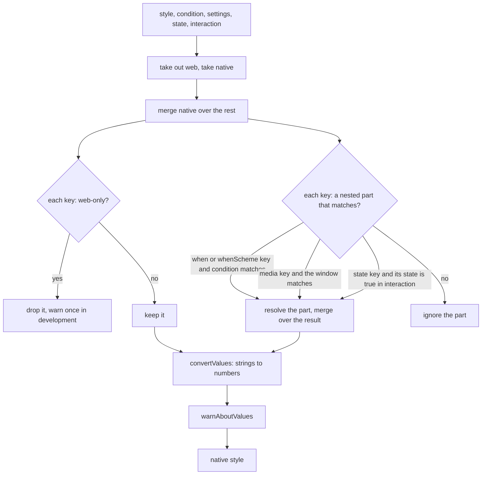

# toNativeStyle.ts

## What it does

`toNativeStyle(style, condition?, settings?, state?, interaction?)` turns one style object, written for either
platform, into a flat native style. `collectKeys(style, into?)` reports what a style depends on besides
itself: condition keys, a scheme key, media queries and state keys.

## Why it exists

A style may carry things a native style cannot: selectors, at-rules, custom properties, `animation*` and
`transition*` keys, a `web` part, a `native` part, `when()`, `whenScheme()` and `state()` keys, and `@media`
keys. Every
place that makes a native style (a styled component, a sheet entry, `css()`) needs the same answer for them,
so this is the one function that resolves a style. `styled.ts` and `createStyle.ts` call both functions.

## The logic

A `when()`, `whenScheme()`, `state()` or media key starts with `@`, so it is dropped as a web-only key
(without a warning, see `warnStyle.ts`) and is also looked at as a part to apply. Matching parts are
resolved by calling `toNativeStyle` on them with the same condition, window state and interaction, then
merged in the order written, over the plain keys. So a state part inside a condition or media part works,
and the reverse.

## The data

`NativeSettings` is `{ remBase, name? }` (`name` only feeds the warnings). `StyleKeys` is
`{ isConditional, hasScheme, queries, states }`: `queries` holds each media key once and `states` each
state name once, in the order met. `isConditional` stays for `when()` and `whenScheme()` only; a state key
does not set it. A
`collectKeys` result is `undefined` when the style has none and no `into` was given, so a plain style costs
no object.

## What it guarantees

- `web` is always dropped, and `native` is merged over the rest.
- Objects and arrays under any other key stay (`shadowOffset`, `transform`).
- With no `condition` a condition part never applies, with no `state` a media part never applies, and with
  no `interaction` a state part never applies (a sheet entry, `css()`).
- The parts that apply are merged after the plain keys, in written order: later wins, as the web writes
  them after the base rule.
- `collectKeys` looks inside `native` and inside every condition or media part, at any depth.
- A `label` key is dropped without a warning; the other web-only keys warn in development.

## Decisions

- Web-only means: `label`, a key with `&`, a key starting with `:`, `@` or `--`, and keys starting with
  `animation` or `transition`. The comment says running an animation on React Native "is not built yet".
- The style is resolved on each call. Callers choose when to call (once for fixed styles, per render for
  conditional ones); the file does no caching.

## Limits

- A key is web-only by its text only: `isWebOnlyKey` has no list of valid native keys, so an unknown plain
  key passes through (`NativeStyleObject` rejects it at compile time only).
