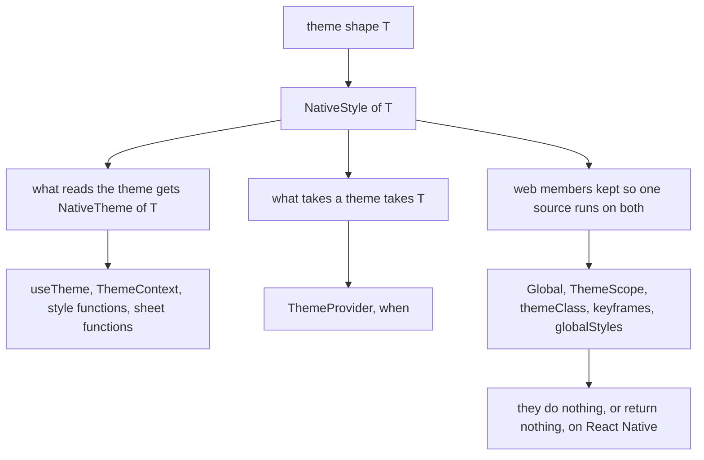

# types.ts

## What it does

Types only: the public shapes of the React Native binding. The main one is `NativeStyle<T>`, what
`createStyle` and the default style return. The rest are the options (`StyleOptions`, `StyledOptions`), the
props of the components (`ThemeProviderProps`, `CacheProviderProps`, `ThemeScopeProps`, `GlobalProps`), the
`styled` and `css` types, and `NativeStyleSheet`. There is no run-time code.

## Why it exists

The binding keeps the names and props of the web binding so one source compiles for both platforms. This
file states which of those props are used here and which are accepted and ignored (`className`, `isRoot`,
the `value` of `CacheProvider`, `Global` props). It also states where the theme is native (`NativeTheme<T>`:
lengths are numbers) and where it is given as written (`T`). `createStyle.ts`, `defaultStyle.ts`,
`styled.ts`, `ThemeValue.tsx`, `CacheProvider.ts` and `index.ts` import it.

## The logic

## The data

- `StyleOptions<T>` extends the core's `BindingOptions<T>` with `remBase` (default 16). Only `remBase` and
  `lengthKeys` are used; any other option is ignored with a development warning.
- `StyledOptions` extends `StylerOptions` with `shouldForwardProp` (default: every prop but `as`, `theme`,
  `style`).
- `StyledComponent<C, P>` takes the props of the tag, `P`, the state props, `as` and `style`.
- `StateProps` is `{ pressed?, hovered?, focused? }`, booleans: what tells a styled component a state its
  `state()` keys name, for a component that does not report it itself (`styled.ts` reads them).
- The `style` prop takes style objects, falsy values and nested arrays (`StyleProp`).
- `NativeStyleSheet<T>` is the platform `StyleSheet` with `create` replaced by two overloads: an object sheet
  gives its styles at once, a function of the theme gives a `SheetDefinition` for `useStyle`.

## What it guarantees

- A sheet made from an object is typed as its own styles, and `useStyle` returns it as it is.
- `SheetDefinition.entries` is never set at run time; it only carries the types.
- `css` is overloaded with the template form first and the styles form last, so a mistake in a style
  object is reported against a style (the comment says so).

## Decisions

- `ThemeProviderProps` accepts `className` and `isRoot` and never renders an element: the provider is
  invisible on the tree.
- The state props are on every styled component, not only on one whose styles name a state: the type of a
  component does not know its styles' keys. A component whose styles name no state forwards them as any
  other prop, as before.
- The `style` prop does not take a function: an author's own function `style` reaches the binding only by
  a cast, and is composed only where the styles name a state (`styled.md`).
- Types describing web-only features remain (`GlobalInput`, `KeyframesInput`) so that a web source typechecks.
