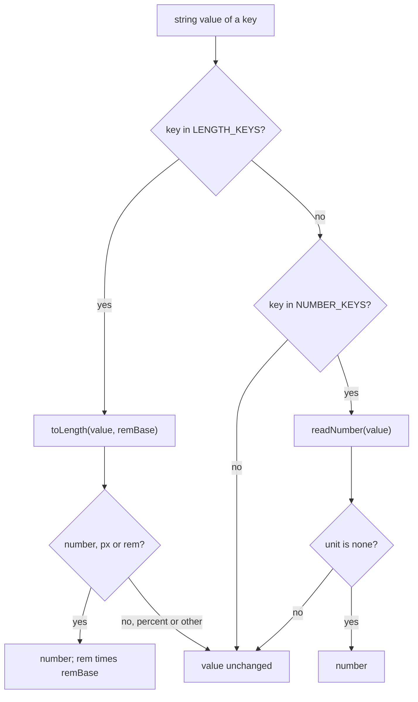

# units.ts

## What it does

Reads numbers and lengths out of strings, and turns the strings of a native style that are lengths or plain
numbers into numbers. It exports the default `rem` base (16), `readNumber`, `toLength`, `convertValues`, and
two key lists: `LENGTH_KEYS` and `NUMBER_KEYS`.

## Why it exists

React Native styles take numbers (density-independent pixels) where the web takes `'8px'` or `'1rem'`. A
shared source writes the web form; this file is the one place that decides which keys take which
conversion. `toNativeStyle.ts` calls `convertValues`, `nativeTheme.ts` calls `toLength`, `calc.ts` calls
`readNumber`, and `createStyle.ts` imports `DEFAULT_REM_BASE`.

## The logic

`convertValues` visits each key of the style in place and only touches string values.

## The data

`readNumber` returns `{ value, unit }` with unit `''`, `'px'`, `'rem'` or `'%'` (lowercased), or `undefined`.
The pattern is `^(-?(?:\d+(?:\.\d*)?|\.\d+))(px|rem|%)?$` after the text is trimmed, so `'3.'` and `'.5'` read
and `'3..5'` does not.

## What it guarantees

- `convertValues` changes values in place and only the strings; numbers and objects are left alone.
- A percentage under a length key stays a string (`toLength` returns `undefined` for `%`).
- A string with no unit under a `NUMBER_KEYS` key becomes a number; one with a unit stays a string.
- The reader does not backtrack on long digit runs (the pattern has no overlapping groups; `calc.test.ts`
  checks a 200000-character input in linear time).
- It touches no platform global.

## Decisions

- Two lists, not one: lengths accept `px` and `rem`, plain numbers accept no unit. The comment above
  `LENGTH_KEYS` says the lists are the keys of the platform styles that take any number, apart from colors,
  and that type tests check them against the platform types.
- `rem` is `remBase` times the number, with `remBase` set by the app (default 16, `DEFAULT_REM_BASE`).

## Limits

- `em`, viewport units and the other CSS units are not converted here; `warnStyle.ts` warns about them.
- Only keys in the two lists are converted; a custom key with `'8px'` stays a string.
