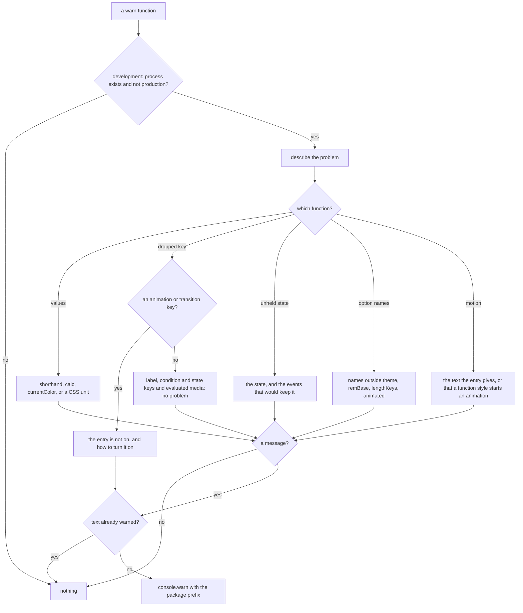

# warnStyle.ts

## What it does

Development warnings for what the types cannot reject: `warnAboutValues` (a style value that was not
converted and is wrong on React Native), `warnAboutDroppedKey` (a web-only key that is dropped by mistake),
`warnAboutQuery` (a `useMediaQuery` text the binding cannot evaluate), `warnAboutIgnoredOptions` (options
of `createStyle` or `configure` that are only for the web), `warnAboutUnheldState` (a function style that
names `hovered` or `focused` in a component that keeps no such state), `warnAboutMotion` (a message of the
animated entry about a value it cannot read or the library would reject) and `warnAboutLateMotion` (a
function style that starts an animation in a component whose object styles name none).

## Why it exists

A shared source can carry values that mean something on the web and nothing on React Native: a shorthand
`'8px 16px'`, `calc(...)`, `currentColor`, `em` or `vh` lengths, selectors, at-rules. Dropping or passing
them silently hides the mistake. This file says what is wrong and what to write instead. `toNativeStyle.ts`
calls the first two, `windowState.ts` the third, `createStyle.ts` the fourth, `styled.ts` the fifth and the
last, and the animated entry (`animatedDriver.ts`, `motionSteps.ts`) `warnAboutMotion`. Its switch,
`isDevelopment` (`NODE_ENV` is not `production`), is exported for `devGuard.ts`, whose checks of the
functions an app gives the binding turn on where its warnings do.

## The logic

## The data

The set `warned` holds the full text of each message, with the component or sheet entry name in front when
known (`sheet entry "card": ...`, `css(): ...`). A dropped-key reason is one of: unsupported media part,
`React Native has no at-rules`, `no custom properties`, `no selectors`. An animation or transition key has a
message of its own (`MOTION_OFF`): the animated entry is not on, and how to turn it on, with no hint about
the `web` part, since the key runs on React Native with the entry.

## What it guarantees

- A message is printed once for each distinct text, for the life of the program.
- Nothing is printed outside development; `process` may not exist, and then nothing is printed.
- `label`, a condition key, a known `state()` key and a media query that is evaluated are not mistakes and
  are never warned about. A selector key such as `&:active` still gets `React Native has no selectors`, as
  before the state keys; a `@state` key with an unknown name gets `React Native has no at-rules`.
- A key that is a media query with an unsupported part is warned about, with the `problem` from
  `mediaQuery.ts`.
- It never throws and never changes a style.

## Decisions

- Only strings are checked, and only the units that are CSS and not native: `em` and the viewport units get
  their own message, the other CSS units a general one.
- The shorthand test accepts two to four values that are lengths or `auto`.
- Warning once (not on every render) is in the code; the reason is not recorded.

## Limits

- A number under a wrong key, or a string under an unknown key, is not checked.
- The set of printed messages is never emptied.
- The message about an animation key names the import and the two calls that turn the entry on; it cannot
  tell whether the library is installed, so it says that the entry needs it.
