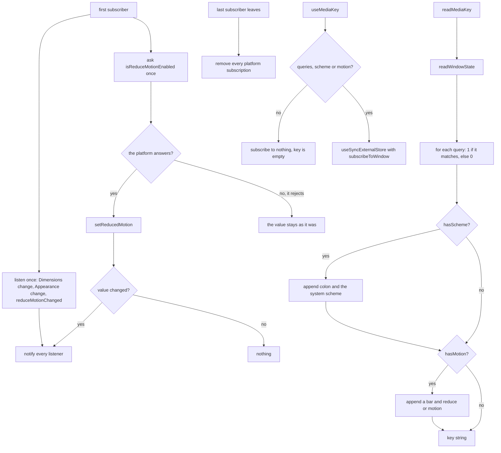

# windowState.ts

## What it does

Reads the window and the system settings, and lets components subscribe to their changes. It gives
`readWindowState()`, `readReducedMotion()`, `subscribeToWindow(listener)`, `readMediaKey(queries, hasScheme,
remBase, hasMotion?)`, the hook `useMediaKey` (the same key in a component) and `useMediaMatch` (the engine
of `useMediaQuery`).

## Why it exists

A style with media keys depends on the window, and a component must render again when the answer changes,
but not on every pixel of a resize. The file turns "which queries match now" into a short string key and
subscribes through `useSyncExternalStore`, so a component renders again only when the key changes.
`styled.ts` and `createStyle.ts` use the key to register one set of styles for each combination of matching
queries; `defaultStyle.ts` calls `useMediaMatch`; `index.ts` re-exports the `MediaQueryOptions` type.

## The logic

## The data

The key is one character for each query (`'1'` or `'0'`), then `:` and the system scheme when `hasScheme`,
then `|reduce` or `|motion` when `hasMotion` (a component that animates): `'101'`, `'10:dark'`, or
`'|motion'`. Module state: `isReducedMotion` (false until the platform answers), a `Set` of
listeners, and the list of platform subscriptions.

## What it guarantees

- The platform is listened to once for all subscribers, and the listeners are removed when the last one goes.
- Two renders with the same key resolve the same style.
- A component with no queries, no scheme and no motion subscribes to nothing and makes no key reader.
- `hasMotion` defaults to false, so every key made before the animated entry is the same text.
- A component that animates subscribes, and renders again when reduced motion changes; `useMediaKey` is the
  same hook whatever it watches, so the hooks of a component do not change when what it watches does.
- Reduced motion is `false` until the platform answers (the comment says this is the platform's default),
  and stays what it was when the platform's answer fails: no rejection is left unhandled.
- `useMediaMatch` of a query with a `problem` warns (development) and subscribes to nothing; its server
  snapshot is `options.defaultMatches ?? false`.

## Decisions

- A string key instead of the width: the component renders again only when the matching set changes.
- One shared subscription, not one per component.

## Limits

- Reduced motion cannot be known at the first render: the first answer arrives asynchronously, then a
  change renders the affected components again.
- When the platform fails to answer (the promise of `isReduceMotionEnabled` rejects), reduced motion keeps
  the value it had, `false` at first, and the failure is not reported; a later `reduceMotionChanged` event
  still sets it.
