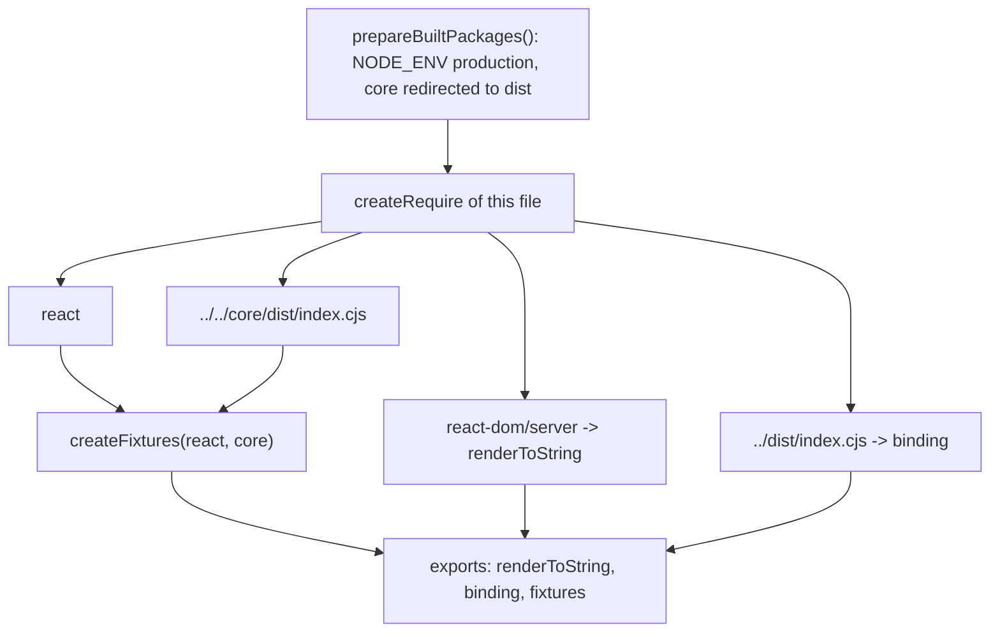

# client.ts

## What it does

Makes the process run built code, then loads and exports what the string-rendering React benchmarks use:
`renderToString` of `react-dom/server`, `binding` (the built `@umber-style/react`, `dist/index.cjs`) and
`fixtures` (`createFixtures` of `fixtures.ts`, over this copy of React and the built core).

## Why it exists

The files that render the client build to a string (`string-elements.bench.ts`, `string-options.bench.ts`,
`string-trees.bench.ts`) must measure the built binding under production React. soroush-bench runs a
file with tsx in a sandbox where nothing sets `NODE_ENV` and where the workspace link of the core points
at source, so the file calls `prepareBuiltPackages` first and loads everything after it with
`createRequire`. A static `import` of React would be resolved before the hook exists. The file keeps that
order in one place; the benchmark files import it before anything that loads React. The binding is typed
by `src` and loaded from `dist`.

## The logic

## What it guarantees

- Every module that reads `NODE_ENV` or `@umber-style/core` is loaded after `prepareBuiltPackages`.
- The fixtures use the same copy of the core that the built binding resolves: the hook redirects the core
  to `dist/index.cjs` and the file loads that same path.
- Nothing at module top level touches a browser global.

## Decisions

- Types come from `src` (`import type`), code from `dist`, so the type check needs no build.
- The benchmark files use `createElement`, not JSX, since React is loaded after the hook
  (`docs/benchmarks.md`).

## Limits

- It needs `pnpm build` first.
- It covers the client build only; the server components build is in `server.ts`, and the files that
  render into a DOM load through `dom.ts`.
