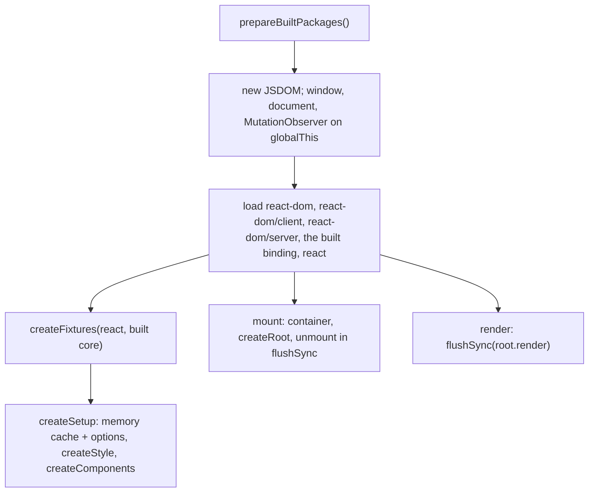

# dom.ts

## What it does

What the React benchmark files that render into a DOM (`dom-trees.bench.ts`, `dom-hydration.bench.ts`)
load, in order: `prepareBuiltPackages` (production React, the built core), a document of jsdom put on
`globalThis` as `window` and `document` with its `MutationObserver`, then `react-dom`, its client and
server entries, the built binding and React. It exports them, the fixtures over React and the built core,
and three helpers:

- `createSetup(options)`: a fresh style object of the client build and its components, over a cache that
  writes into memory, has no development checks, and takes `options` on top.
- `mount()`: a container in the document with a root over it, and `unmount`, which unmounts the root
  inside `flushSync` and removes the container.
- `render(root, element)`: `root.render` inside `flushSync`, so the render is committed when it returns.

## Why it exists

The sandbox has no DOM, and React and the binding read `document` as they start, so the document must be
there before they load. The two files share the setup, the mount and the render.

## The logic

## What it guarantees

- The engine never writes into jsdom's style sheet: every cache here has an in-memory sheet.
- Everything that reads `document` at load is loaded after the document exists.

## Limits

- jsdom is not a browser: it computes no layout and paints nothing, so the figures hold React's render
  and commit, the engine's work and jsdom's DOM operations, not a browser's.
