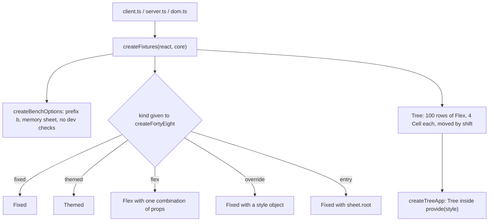

# fixtures.ts

## What it does

Defines the components the React benchmarks render and the helpers that make elements and trees from
them. `createComponents(style)` makes `Fixed`, `Themed`, `Flex`, `Cell` and a sheet over a style object.
`createFixtures(react, core)` returns `createBenchOptions`, `createFortyEight`, `provide`,
`createTreeApp` and `Tree`, over one copy of React and of the built core. The file also exports `theme`,
`otherTheme`, the 48 `combinations` and the type `BenchStyle`.

## Why it exists

The same components must be measured on two builds: the client build (`createStyle`) and the server
components build (`bindEngine`). `BenchStyle` is the part of a style object that both give (`styled`,
`StyleSheet`, `ThemeProvider`), so one definition serves both. React and the core are arguments, not
imports, because `client.ts` and `server.ts` load them built and under their own conditions
(`prepareBuiltPackages`); a static import here would load another copy. Users: `client.ts`, `server.ts`,
`dom.ts`, and the benchmark files `dom-trees`, `server-elements`, `server-trees`, `string-elements`,
`string-options` and `string-trees`. The shared inputs come from `bench/src`.

## The logic

## The data

- 48 combinations of layout props (`createCombinations(48)`); the key of an element is
  `createLayoutKey(props)`.
- `Tree`: 100 rows, each a `Flex` with 4 `Cell`s: 500 styled elements. Row `r` takes
  `combinations[(r + shift) % 48]`, cell `c` takes `TONES[(c + shift) % TONES.length]`, so another
  `shift` changes props everywhere and the class of most elements.
- `Flex` keeps its six layout props from the element (`shouldForwardProp`); `Cell` keeps `tone`.

## What it guarantees

- Every cache made by `createBenchOptions` has its own in-memory sheet and no development checks.
- The module loads no React and no core itself: only types are imported from them.
- `provide` uses the small theme unless a value is given.

## Limits

- `otherTheme` has only a primary and a text colour: it is for a nested provider, not a full theme.
