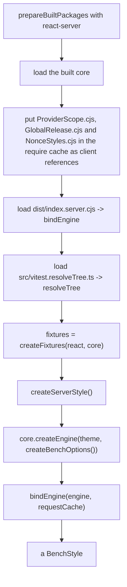

# server.ts

## What it does

Makes the process run built code under the `react-server` condition, then loads and exports what the
server components benchmarks use: `resolveTree` (the helper of the server tests), `fixtures`
(`createFixtures` over the server build of React and the built core) and `createServerStyle()`, a fresh
style object of the server build over a fresh engine and an in-memory cache.

## Why it exists

`server-elements.bench.ts` and `server-trees.bench.ts` measure what a server components render does with
the engine. In an app, the `react-server` condition selects the server build of React (no hooks) and of
the binding (`dist/index.server.cjs`). The sandbox sets no condition, so `prepareBuiltPackages` is given
`conditions: ['react-server']`. `resolveTree` comes from `src/vitest.resolveTree.ts`, loaded by tsx,
because it is a test helper and not part of the built package.

## The logic

## The data

- `requestCache`: a `CacheFunction` that keeps one value in a closure. In a real render `React.cache`
  keeps the request's slot; here the slot lives as long as the style object, as in the tests.
- A require cache entry: `{ id, filename, loaded: true, exports: { [name]: reference } }` with
  `reference = { $$typeof: Symbol.for('react.client.reference'), $$id: name }`, for `ProviderScope`,
  `GlobalRelease` and `NonceStyles`.

## What it guarantees

- `ProviderScope`, `GlobalRelease` and `NonceStyles` are client references when the server build loads, so the work
  measured is that of a server: a bundler of server components does not run a `'use client'` module that
  a server file imports, and `resolveTree` leaves a reference as it is (`src/vitest.clientReferences.ts`).
- Each `createServerStyle()` call gives a fresh engine and cache, so one case does not warm another.
- The cache is in memory and has no development checks (`createBenchOptions`).

## Decisions

- The three modules are put in the require cache before the server build loads them. Why this and not
  another way of making them references is not recorded in the code.

## Limits

- It needs `pnpm build` first.
- The three cached module names are a list in the file: a new client module that the server build imports
  needs an entry, and nothing checks that the list is complete.
- `resolveTree` runs from source, not from `dist`.
