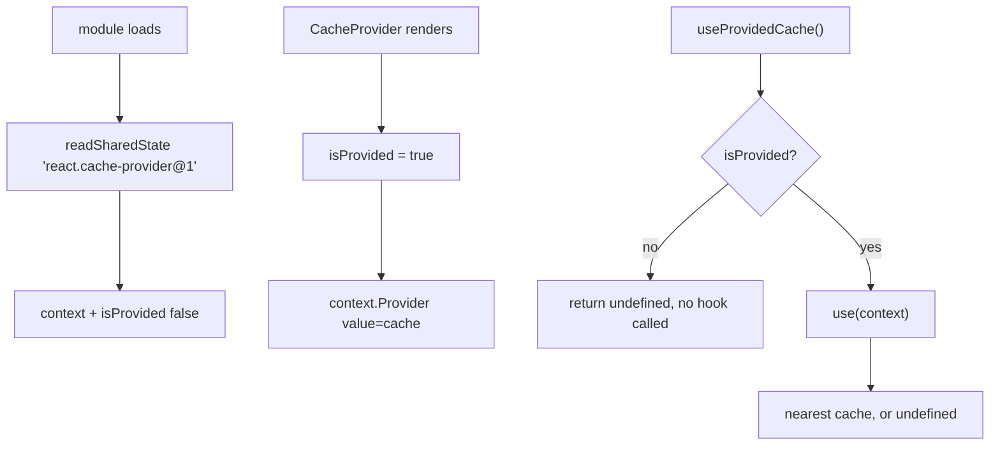

# CacheProvider.tsx

Build: client (`'use client'`). The server build does not have it.

## What it does

`CacheProvider` gives the subtree below it a `Cache`. Every component of the binding below it writes its
rules into that cache instead of the engine's own. `useProvidedCache` is the read side: it returns the
cache of the nearest provider, or `undefined` with none above.

## Why it exists

An app can need two caches in one program: one for each iframe, one for each request of a server render, a
registry that a server-rendering set-up reads. Without a provider the engine has a single cache, and the
rules of every tree land in it. `styled.ts`, `createStyle.ts`, `Global.ts`, `ThemeProvider.tsx` and
`ThemeValue.tsx` all call `useProvidedCache` and switch to `engine.withCache(cache)` when it returns a
cache. It is its own file so that all of them import one context without importing each other.

## The logic

The state is made once per program by `readSharedState`, so two copies of the binding share one context. The
flag starts false, so an app with no provider never reads the context. Rendering a provider sets it for good.

## The data

`{ context: Context<Cache | undefined>, isProvided: boolean }`, stored under the key
`react.cache-provider@1`.

## What it guarantees

- Before any provider has rendered, `useProvidedCache` calls no React API and returns `undefined`.
- It reads the context with `use`, which React does not count among the hooks, so a component that starts
  to read it after a provider rendered keeps its hooks in order (`CacheProvider.order.test.tsx`).
- Every copy of the binding in the program sees the same context.
- It never touches a browser global.

## Decisions

- `use` instead of `useContext`, and a flag in front of it: the comment in the file gives both reasons
  (no cost without a provider; a stable hook order when one appears later).
- The flag is never reset. Once a provider has rendered in the program, every component reads the context.

## Limits

- `isProvided` is a module-level flag. It says a provider has rendered somewhere, not that one is above this
  component; the context value decides that (`undefined` with none above).
