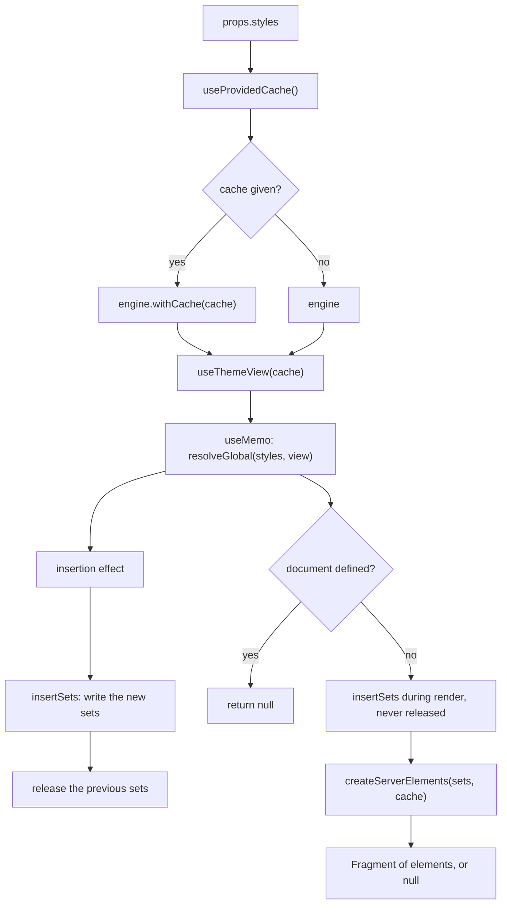

# Global.ts

Build: client (the `Global` that `createStyle.ts` makes). Its server counterpart is `Global.server.ts`.

## What it does

`createGlobal(engine, useThemeView, createServerElements)` makes the `Global` component. It resolves the
global styles of its props against the view of the theme, writes the resulting sets into the cache, and
renders nothing in the browser. Where there is no document it also renders the style elements, or the
marker, that name the sets.

## Why it exists

Global rules (`body { margin: 0 }`, `@keyframes`) must exist while a component is mounted, go when it
unmounts, and follow the theme. This file ties that lifecycle to React. `createStyle.ts` is the only
importer; it passes in its own `useThemeView` and a function that picks style elements or the marker.

## The logic

## The data

A set is a `GlobalRules`: `{ id, rules, animations }`. `held` is a ref to the function that releases every
set the component wrote.

## What it guarantees

- When the sets change, the new ones are written before the old ones are released, so there is no moment
  with neither.
- The cache counts the rules of a set: two elements with equal styles share them, and an effect that runs
  twice in development writes them back.
- On unmount the held rules are released and the ref goes back to a no-op.
- Where there is no document, nothing unmounts, so the rules are written during the render and kept.
- The hooks are the same on every render, with or without a provider.

## Decisions

- Insertion effects, not layout effects, so the rules are in the sheet before the page changes.
- Two insertion effects: one for write-then-release on a change, one that releases only on unmount.
- The server branch writes during render because no effect runs there (a comment in the code says so).

## Limits

- It does not remove a set whose element a server render sent, by itself; it relies on the cache taking
  over those rules (see `GlobalRelease.ts` for the server-component case).
