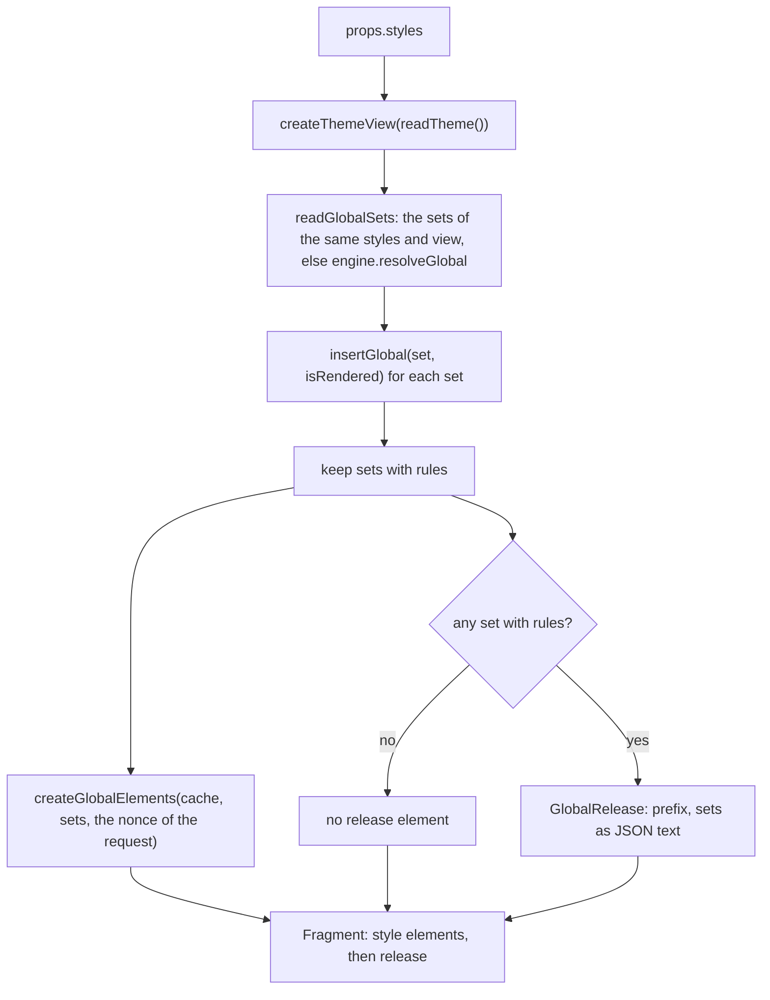

# Global.server.ts

Build: server (components build, no hook and no context). The client counterpart is `Global.ts`.

## What it does

`createGlobal(engine, readTheme)` makes the `Global` for server components. It resolves the global styles
against the view of `readTheme()`, writes every set into the cache for good, and returns the style elements
of the sets and of the animations they use, followed by a `GlobalRelease` element when any set has rules.

## Why it exists

A server component cannot use a hook or an effect, and nothing unmounts on a server, so the rules are
written once during the render and sent as elements. The browser still needs to know about them, so that a
navigation away can release them: that is the job of the client component `GlobalRelease`, which this file
renders with the sets as plain JSON text. `createStyle.server.ts` is the importer.

## The logic

## The data

The props of `GlobalRelease`: `prefix` (the cache prefix) and `sets`, the `JSON.stringify` of `[id, rules][]`.

## What it guarantees

- No hook, no context. `serverGuard.test.ts` checks that the files of the server build call none.
- `GlobalRelease` is imported from a `'use client'` file, so in a bundler of server components the import is
  a reference to it; it is never run on the server (`vitest.clientReferences.ts` mocks it the same way).
- React sends each `href` once, however many components render the same set.
- The style elements carry the nonce of the request (`readNonce`): the cache's, or the answer of the
  source registered with `setNonceSource`; it returns a Promise of its elements while that has not come.

## Decisions

- The sets are sent as text, not as an object, so the same sets in a new payload are equal (comment in
  `GlobalRelease.ts`).
- The view of the theme comes from `readTheme`: base theme, else the first provider of the request, else empty.
- The sets are those of `readGlobalSets` (`styleElements.ts`): a render with the styles and the view of a
  render before gets the sets resolved then, so a function of the theme is not called again (nor the `css`
  template it returns read again).

## Limits

- Nothing is released on the server: the rules stay in the cache for the life of the process.
