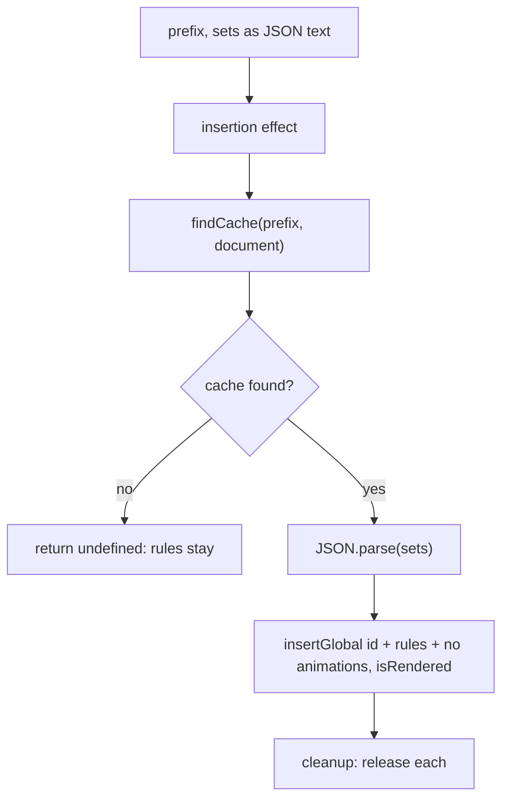

# GlobalRelease.ts

Build: client (`'use client'`). The server build reaches it by reference, from `Global.server.ts`.

## What it does

`GlobalRelease` renders nothing. In an insertion effect it finds the cache of a prefix in the page, parses
the sets that a server `Global` wrote, and has the cache take each of them over. On unmount it releases them.

## Why it exists

The style elements of a server `Global` stay in the document for good: React keeps a style element it
hoisted. Without this component those rules would never go when the page is left in a client-side
navigation. With it the cache owns the rules, deletes them from the element's sheet on unmount, and writes
them again if the component mounts later and the element no longer has them.

## The logic

## The data

`sets` is a list of `[id, rules]`, with `rules` an array of strings. Animations are not sent: the rule of an
animation is its own style element, and this component passes an empty list.

## What it guarantees

- It writes nothing again for equal sets in a new payload (the text is equal, so the effect does not run).
- With no cache of the prefix in the page, it does nothing (`GlobalRelease.test.tsx`).
- It uses `import * as React`, so loading the module with the server build of React does not fail.

## Decisions

- Text for `sets`, so that the dependency comparison is by value.
- The text of the element keeps the rules: nothing parses it again, since React neither moves nor rewrites a
  style element in the head (comment in the file).

## Limits

- It does not release the animations of the sets.
