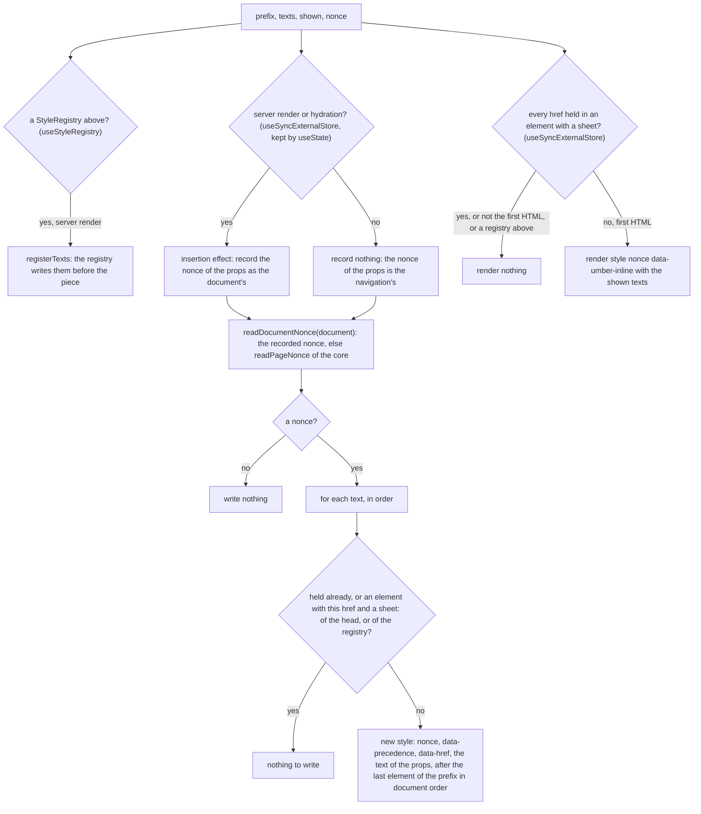

# NonceStyles.tsx

Build: client (`'use client'`). The server build reaches it by reference, from `inlineStyles.server.ts`;
`ProviderScope.tsx` renders it too.

## What it does

`NonceStyles` holds the style texts of one component of the server build in a request that had a nonce,
from a nonce source or the cache (`inlineStyles.server.ts` decides that). It never renders an element that React
hoists:

- In the first HTML (the server render of the client component, and its hydration) it renders a
  `<style nonce data-umber-inline="<prefix> <href>...">` in place, with the texts of `shown` (all when it
  is absent). React does not hoist a style element with no `precedence`, so the element keeps its nonce
  and the policy lets it in with no script.
- At hydration it writes every text into an element of the head, with the nonce of the document, then
  renders nothing, so React removes the element in place.
- Under a `StyleRegistry` (`next.tsx`), the server render registers every text in the registry of the
  request (`styleRegistry.ts`), which writes them before the piece of the stream that holds the element,
  and renders nothing, in the first HTML and at its hydration. Its insertion effect then finds each text in
  an element of the registry and writes nothing.
- Mounted after the first HTML (the page of a client-side navigation) it renders nothing and writes its
  texts with the document's nonce after the last style element of its prefix in document order (React's
  in the head, this module's, the registry's, which may be at the top of the body), so React never inserts
  an element with the nonce of the navigation's request, which the policy of the document refuses.

`readDocumentNonce(page)` gives the nonce the elements of the head are written with.

## Why it exists

A framework that gives React no style nonce (Next.js 16.4.6 gives it a string, the script nonce only)
makes React's merged `<style data-precedence>` element nonce-less, and a framework that makes a nonce for
each request sends a navigation's elements with a nonce the document does not allow. The element in place
answers the first; writing into the head with the document's nonce answers the second.

## The logic

`readDocumentNonce` looks, in order, at: the nonce recorded at hydration (the props of the first HTML came
with the payload of the document's own request), then the nonce of the page as the core reads it
(`readPageNonce` of `@umber-style/core/internal`: the `.nonce` of a `style[nonce]` that has a sheet, the
policy let it in, else the `.nonce` of a `script[nonce]`). None of these: `undefined`. The engine's cache
gives the same nonce of the page to the elements it makes for itself when it has none (`documentNonce.md`
of the core), so the elements this module writes and those of the cache carry one nonce.

## The data

- `held`: a module `Map` from an `href` to the element that holds it: one this module wrote (kept even
  when the policy refused it, so it is not written again and again), or one of the page found with a
  sheet: a `style[data-href]` of the head, or a `style[data-umber-registry][data-umber~="<prefix>"]` that
  a `StyleRegistry` wrote, in the head or at the top of the body.
- `recordedNonce`: the nonce of the document, the first one recorded at hydration.
- The two `useSyncExternalStore` stores have nothing to subscribe to: whether a render is the first HTML
  is the server snapshot against the browser's, and whether the texts are handed changes only in the
  commit of the component itself (its insertion effect writes them), which React checks after a
  hydration and which a render after it reads.

## What it guarantees

- The text of an element it writes comes from its props only (the app's own server payload), never from
  an element of the page.
- An `href` counts as present only when its element has a sheet: an element that the policy refused (one
  injected with no nonce) holds no rule, so it can neither be applied again nor stand in for a rule.
- It writes new `<style>` elements with the document's nonce, never rules through `insertRule`: the CSP3
  specification gates CSSOM insertion on `'unsafe-eval'`; browsers do not enforce it today, and this does
  not rely on that gap.
- The element in place stays until the head holds every text in an element the policy let in: with no
  nonce found, or with what was written refused, the page keeps the styles of its first HTML.
- No flash at hydration: the head is written in the insertion effect, before the element in place goes,
  and both hold the same rules (scenario (h3) of `e2e/helpers/cspServer.ts`).
- The elements it writes have the form React gives its own (`data-precedence`, `data-href`), after the last
  element of the prefix in document order (`style[data-precedence]` of the head, the elements of a
  `StyleRegistry`), in the order of first use: a props class a navigation brings comes after a base class
  that a later piece of the stream put at the top of the body. `keepRootRule` of `ProviderScope.tsx` finds
  them.
- With no `StyleRegistry` above, what it renders and writes is what it did before the registry: the
  elements of a registry an app writes itself (no `data-umber-registry`) are neither read nor counted.
- Hydration accepts the first HTML: the first render in the browser is the same as the server's.

## Decisions

- New elements carrying the document's nonce, not `insertRule` into an allowed sheet (see above).
- The nonce the props carry is used as the document's only at hydration: after it, the props come from the
  request of a navigation.
- With no nonce found nothing is written, rather than an element the policy would refuse and report.
- Under a registry it renders nothing on both sides, so hydration sees the same tree, and the elements of
  the later pieces stay at the top of the body, where the registry wrote them: moving them into the head
  would make the browser parse their rules again, and the engine's cache holds the rules it read there.

## Limits

- Without a `StyleRegistry`, with JavaScript off the element stays in place: as a child among the app's elements it shifts
  `:first-child`, `:nth-child` and `+`. Inside a `<select>` the HTML parser of the specification drops a
  `<style>`, so a styled `<option>` can be unstyled; Chromium 158 keeps it and applies it, other browsers
  were not run.
- A page whose first HTML hydrated no `NonceStyles`, and that has no applied style element or script with a
  nonce, writes nothing after a navigation: the classes only the navigation brings are unstyled, with no
  violation reported.
- `held` and the recorded nonce live as long as the page (the module).
- Without a `StyleRegistry`, a text is shown in place once in a request (`shown`): a class first shown in
  the fallback of a `Suspense` boundary has no rule for a frame when React's script swaps the content in
  before the boundary hydrates (22 to 30 ms, measured on the prototype of the registry and seen again on
  the fixture's `/csp-inplace`). Under a registry the rule is in the piece of the fallback, before it.
