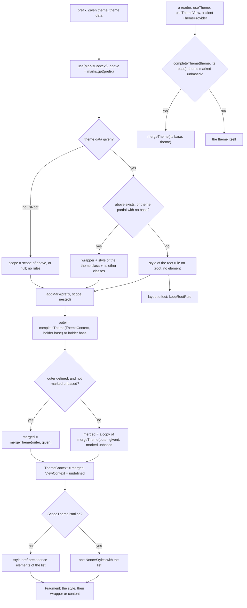

# ProviderScope.tsx

Build: client (`'use client'`), used by both builds. The server build reaches `ProviderScope` by reference,
from `ThemeProvider.server.ts`; the client build imports the marks, the contexts and the rule makers from it.

## What it does

It holds what every provider shares: the marks (which provider is above, for each engine), the theme
contexts of one prefix, the registry of styles by prefix, the themes given with no base theme under them
(`completeTheme`), and the functions that write the text of a root rule and of a theme class from plain data. It also defines `ProviderScope`, the component that is the browser
part of a server-build `ThemeProvider`: it decides in the tree whether it is nested or outermost, renders the
style elements and the wrapper, and fills the contexts below it.

## Why it exists

A server component cannot see the providers above it, and a server render of one segment of a page (a
client-side navigation) does not render the layouts above it. So the server build decides nothing; it hands
this component the theme and the data of both outcomes, and this component decides as the tree renders, the
same way on the server (first HTML) and in the browser. The marks and contexts are in this file because the
client `ThemeProvider.tsx`, `ThemeValue.tsx`, `defaultStyle.ts` and `createStyle.ts` must read the same ones.

## The logic

`outer` is the `ThemeContext` of the prefix, else the base theme of the `holder` (the engine of the client
build, once one exists). The holder is set when the first style of the client build of the prefix is
loaded, and a provider can render before that: on the first request of a server, at hydration (React
renders the provider before the module of a client component below it is evaluated), and when a
client-side navigation brings a page whose client components load that style. With no theme above and no
holder, the theme it gives is a copy of the given theme, marked in a shared `WeakSet`
(`react.unbased-themes@1`): it has no base theme under it. A nested provider over a marked theme marks
its own too, unless the holder has appeared since, in which case `completeTheme` merges the base under the
marked theme first. Every reader of the client build completes a marked theme with the base theme of its
own engine (`completeTheme`), so it reads what it would have read had the style been loaded first.

## The data

- `ProviderMarks`: a `Map` from a key (the cache prefix, or a `Cache` when a `CacheProvider` gave another)
  to `{ scope, nested }`, where `scope` is `{ as, className }` of the nearest nested wrapper, or `null`,
  and `nested` the themes of the nested providers down to the nearest one, merged (undefined when none is
  above). A nested `ProviderScope` adds its given theme to the `nested` above, the outermost one adds
  nothing, and one with no rules (`isRoot`) passes the one above on. It makes no class of it: a nested
  provider of the client build below reads it for the class of the nested themes merged.
- `PrefixStyle`: `{ contexts, holder? }`, one for each prefix, in `readPrefixStyle`'s map.
- The unbased themes: a `WeakSet` of the theme objects a `ProviderScope` gave its `ThemeContext` with no
  base theme under them. `mergeTheme` keeps each merge of a pair of objects, so `completeTheme` gives the
  same object for the same theme and base each time, and the view the engine keeps for it is reused.
- `ScopeTheme`: everything the server build computed for either outcome: `as`, `className`, `classId`,
  `rootId`, `layerOrder`, `tokens`, `properties`, `isWhole`, optional `base`, `styles`, the optional `nonce`
  (the cache's, or the request's in inline mode), which every style element rendered here carries as its
  `nonce` prop, and `isInline`: the request had a nonce (from a source or the cache), so the style texts go to
  `NonceStyles`.
- A style element as data is a `StyleText`: `{ href, text }`.

## What it guarantees

- The marks and prefix registry are shared by every copy of the binding (`readSharedState` keys
  `react.marks@1` and `react.prefix-styles@1`), so a provider of one copy is seen by a style of another.
- The marks context is made on first use, and no React API is called when the module loads, so loading it
  under the server build of React works.
- `ViewContext` is set to `undefined` below this component, so what reads it builds the view from
  `ThemeContext`.
- A client component below reads the theme merged over the base theme of its style whether or not that
  style was loaded when the provider rendered: its class is the same on the first request of a server, on
  a later one, at hydration and after a client-side navigation (#71). A theme with a base under it is not
  marked, and `completeTheme` gives it back as it is: where the holder was there when the provider
  rendered, nothing changes.
- `keepRootRule` skips a style element that has no sheet: one that a content security policy refused
  (its nonce is not the page's) holds no rule, and reading it threw and took the page down.
- `keepRootRule` leaves one root rule of the prefix in the style elements React keeps and in those a
  `StyleRegistry` wrote (`data-umber-registry`, found by `data-umber`), which stand for React's under a
  registry, and touches no element of the browser's cache or of a registry an app writes itself.
- The server and the browser write the same text from the same props, with the core's tokens and no engine.
- Every style element it renders has the `nonce` of `ScopeTheme`, so under a policy that allows style
  elements by nonce React keeps their rules on the server and the browser lets in the ones it adds.
- With `isInline` it renders no `<style href precedence>` element: one `NonceStyles` with its list (the root
  rule, or the theme class and the other classes), which is a `<style nonce>` in place in the first HTML and
  writes into the head with the document's nonce in the browser (`NonceStyles.md`). `keepRootRule` then
  finds the element of `rootId` that `NonceStyles` wrote, as it has `data-precedence` and `data-href`.

## Decisions

- The choice between nested and outermost is made here, not in the server build (the comment on
  `createThemeProvider` in `ThemeProvider.server.ts` gives the reason: the server cannot see the layouts).
- A provider with a partial theme and no base theme to put under it is nested, not outermost
  (`!isWhole && base === undefined`).
- `claimPrefixStyle`: the default style makes its contexts before its engine and prefix exist, so it claims
  the prefix it will have, read on demand.
- The base theme is completed where it is read, not where the provider renders: the provider cannot wait
  for a module that only a component below it loads. Rejected: sending the base theme with every provider
  of the server build (it would add the base theme to the payload of every page, which today holds it only
  for the first provider of a request whose theme is partial); rendering the provider again when the
  holder appears (the first render of the component below would still be wrong). Only a marked theme is
  completed, so a theme a provider of the client build or an app put in the context is read as before.

## Limits

- `keepRootRule` matches the root rule by a pattern on `cssText` and does nothing when the element of
  `rootId` is not yet in the document.
- A marked theme is completed with the base theme of the engine of the reader. Two styles of one prefix
  with different base themes, loaded after the provider rendered, each read their own; a provider of the
  client build whose engine has no base theme, below a marked theme, gives a theme that is not marked.
