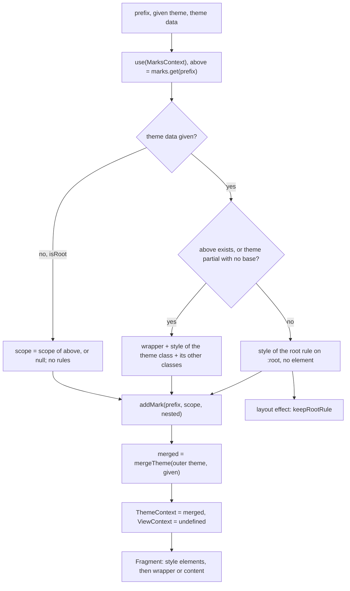

# ProviderScope.tsx

Build: client (`'use client'`), used by both builds. The server build reaches `ProviderScope` by reference,
from `ThemeProvider.server.ts`; the client build imports the marks, the contexts and the rule makers from it.

## What it does

It holds what every provider shares: the marks (which provider is above, for each engine), the theme
contexts of one prefix, the registry of styles by prefix, and the functions that write the text of a root
rule and of a theme class from plain data. It also defines `ProviderScope`, the component that is the browser
part of a server-build `ThemeProvider`: it decides in the tree whether it is nested or outermost, renders the
style elements and the wrapper, and fills the contexts below it.

## Why it exists

A server component cannot see the providers above it, and a server render of one segment of a page (a
client-side navigation) does not render the layouts above it. So the server build decides nothing; it hands
this component the theme and the data of both outcomes, and this component decides as the tree renders, the
same way on the server (first HTML) and in the browser. The marks and contexts are in this file because the
client `ThemeProvider.tsx`, `ThemeValue.tsx`, `defaultStyle.ts` and `createStyle.ts` must read the same ones.

## The logic

`outer` is the `ThemeContext` of the prefix, else the base theme of the `holder` (the engine of the client
build, once one exists).

## The data

- `ProviderMarks`: a `Map` from a key (the cache prefix, or a `Cache` when a `CacheProvider` gave another)
  to `{ scope, nested }`, where `scope` is `{ as, className }` of the nearest nested wrapper, or `null`,
  and `nested` the themes of the nested providers down to the nearest one, merged (undefined when none is
  above). A nested `ProviderScope` adds its given theme to the `nested` above, the outermost one adds
  nothing, and one with no rules (`isRoot`) passes the one above on. It makes no class of it: a nested
  provider of the client build below reads it for the class of the nested themes merged.
- `PrefixStyle`: `{ contexts, holder? }`, one for each prefix, in `readPrefixStyle`'s map.
- `ScopeTheme`: everything the server build computed for either outcome: `as`, `className`, `classId`,
  `rootId`, `layerOrder`, `tokens`, `properties`, `isWhole`, optional `base`, `styles`, and the optional
  `nonce` of the cache, which every style element rendered here carries as its `nonce` prop.
- A style element as data is a `StyleText`: `{ href, text }`.

## What it guarantees

- The marks and prefix registry are shared by every copy of the binding (`readSharedState` keys
  `react.marks@1` and `react.prefix-styles@1`), so a provider of one copy is seen by a style of another.
- The marks context is made on first use, and no React API is called when the module loads, so loading it
  under the server build of React works.
- `ViewContext` is set to `undefined` below this component, so what reads it builds the view from
  `ThemeContext`.
- `keepRootRule` leaves one root rule of the prefix in the style elements React keeps, and touches no
  element of the browser's cache or a registry.
- The server and the browser write the same text from the same props, with the core's tokens and no engine.
- Every style element it renders has the `nonce` of `ScopeTheme`, so under a policy that allows style
  elements by nonce React keeps their rules on the server and the browser lets in the ones it adds.

## Decisions

- The choice between nested and outermost is made here, not in the server build (the comment on
  `createThemeProvider` in `ThemeProvider.server.ts` gives the reason: the server cannot see the layouts).
- A provider with a partial theme and no base theme to put under it is nested, not outermost
  (`!isWhole && base === undefined`).
- `claimPrefixStyle`: the default style makes its contexts before its engine and prefix exist, so it claims
  the prefix it will have, read on demand.

## Limits

- `keepRootRule` matches the root rule by a pattern on `cssText` and does nothing when the element of
  `rootId` is not yet in the document.
