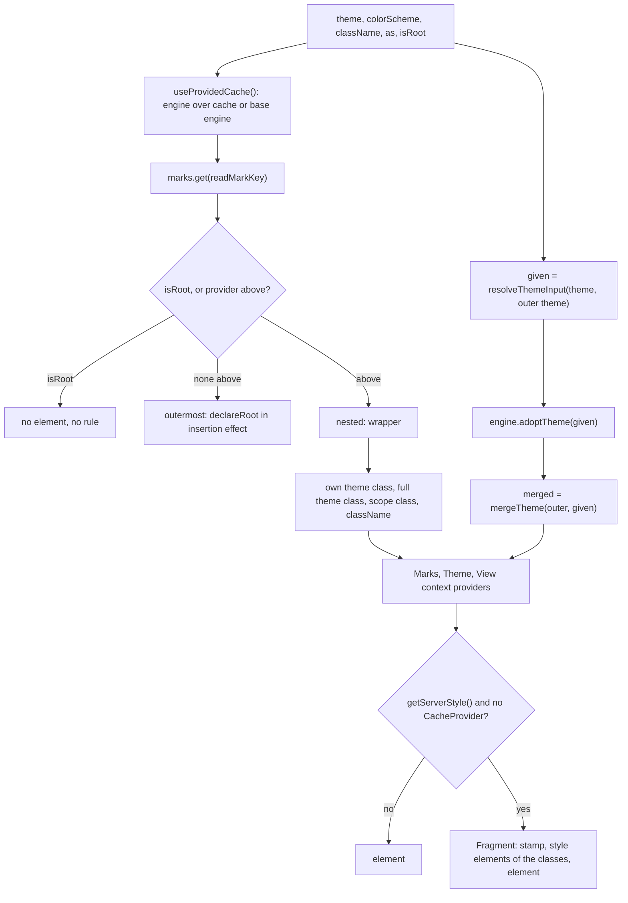

# ThemeProvider.tsx

Build: client (`'use client'`).

## What it does

`createThemeProvider({ engine, contexts, getServerStyle })` makes the web `ThemeProvider` of the client
build. It merges the theme it is given over the theme above, gives the merged theme and its view to the
contexts, and either declares the theme on `:root` (outermost), renders a wrapper with theme classes
(nested), or renders nothing of its own (`isRoot`).

## Why it exists

Components below need the real theme (`useTheme`), the view that function styles read, and a theme class
that scopes the variables. This file decides which of the three roles a provider has and writes the rules
for it. `createStyle.ts` is the importer. The server-build counterpart is `ThemeProvider.server.ts`, and
both read the same marks from `ProviderScope.tsx`.

## The logic

## The data

- `ThemeProviderParts<T>`: the engine, its contexts, and `getServerStyle()`, which is `undefined` in the
  browser and `{ createStyleElements, createStamp }` for a server render of the client build.
- A wrapper is `{ as, className }`; the mark below is `{ scope: wrapper ?? above?.scope ?? null }`.

## What it guarantees

- The outermost provider renders no element and changes its `:root` rule in an insertion effect, so a change
  of theme renders no styled component. With no document it declares the root during the render.
- A nested provider's wrapper carries the theme class of its own theme and of the merged theme (every
  variable), so it is right in a portal outside the wrapper above.
- Under a `CacheProvider` it uses the engine over that cache, sends no style element, and is outermost when
  no provider of that cache is above.
- A provider of the server build above counts: the marks are the same.

## Decisions

- The first provider calls `engine.adoptTheme(given)` so the engine learns the shape of the tokens. The
  comment says this is not a base theme: a tree with no provider never reads it.
- The full-theme class is left out when the own class already starts with it.

## Limits

- Hooks are `use`, `useContext`, `useMemo`, `useInsertionEffect`; this file cannot be in the server build.
