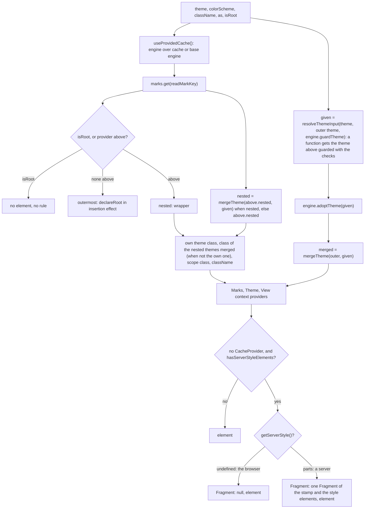

# ThemeProvider.tsx

Build: client (`'use client'`).

## What it does

`createThemeProvider({ engine, contexts, hasServerStyleElements, getServerStyle })` makes the web
`ThemeProvider` of the client
build. It merges the theme it is given over the theme above, gives the merged theme and its view to the
contexts, and either declares the theme on `:root` (outermost), renders a wrapper with theme classes
(nested), or renders nothing of its own (`isRoot`).

## Why it exists

Components below need the real theme (`useTheme`), the view that function styles read, and a theme class
that scopes the variables. This file decides which of the three roles a provider has and writes the rules
for it. `createStyle.ts` is the importer. The server-build counterpart is `ThemeProvider.server.ts`, and
both read the same marks from `ProviderScope.tsx`.

## The logic

## The data

- `ThemeProviderParts<T>`: the engine, its contexts, `hasServerStyleElements` (the option of the style),
  and `getServerStyle()`, which is `undefined` in the browser and `{ createStyleElements, createStamp }` for
  a server render of the client build.
- A wrapper is `{ as, className }`; the mark below is `{ scope: wrapper ?? above?.scope ?? null, nested }`.
- `nested` is the themes of the nested providers from the one below the outermost provider down to this
  one, merged: undefined under the outermost provider, the theme given for a nested provider directly under
  it (the same object, so its class is the own class), and `isRoot` passes on the one above.

## What it guarantees

- The outermost provider renders no element and changes its `:root` rule in an insertion effect, so a change
  of theme renders no styled component. With no document it declares the root during the render.
- A nested provider's wrapper carries the theme class of its own theme and the class of `nested` (every
  variable of the nested themes that the page uses), so it is right in a portal outside the wrappers
  above. It never declares the theme of the outermost provider, which is on `:root` or on the class of
  `<html>`: a switch of that class reaches the tokens that no nested provider changes.
- `useTheme()`, the contexts and the view are the whole merged theme (`merged`), as before.
- Under a `CacheProvider` it uses the engine over that cache, sends no style element, and is outermost when
  no provider of that cache is above.
- A provider of the server build above counts: the marks are the same.
- A server and the browser render the same tree: outside a cache provider, with `hasServerStyleElements`,
  the stamp and the style elements are one place in front of the content, which the browser renders as
  `null`. React's `useId` makes an id from the place of a component in the tree, and the whole app is under
  the outermost provider (`useIdHydration.test.tsx`). The HTML is the same as before the place was added.

## Decisions

- The first provider calls `engine.adoptTheme(given)` so the engine learns the shape of the tokens. The
  comment says this is not a base theme: a tree with no provider never reads it.
- The class of `nested` is left out when the own class already starts with it (always directly under the
  outermost provider).
- The outermost theme is left out of `nested` (it used to be in the merged class): it reaches every
  element from `:root` or `<html>`, and declared again on a wrapper it hid a switch of the class on
  `<html>` from the tokens a nested provider did not change.

## Limits

- Hooks are `use`, `useContext`, `useMemo`, `useInsertionEffect`; this file cannot be in the server build.
- With `isRoot` and the class of the theme on an ancestor other than `<html>` (a `
`), a provider in
  portal content outside that ancestor does not see the root theme: neither `:root` nor its wrapper
  declares it.
