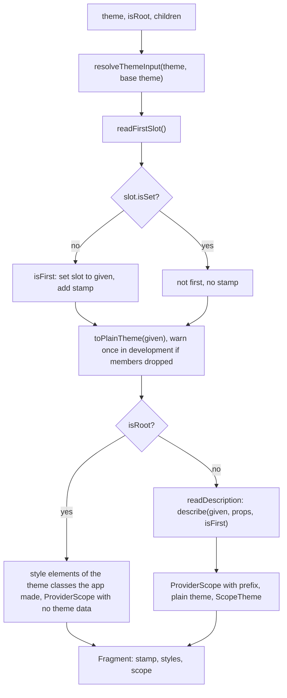

# ThemeProvider.server.ts

Build: server (components build: no hook, no context).

## What it does

`createThemeProvider(engine, parts)` makes the `ThemeProvider` for server components. It resolves the theme
it was given (a function is called with the base theme), turns it into plain data, computes the text and
names of the rules for both outcomes (nested, outermost), and renders `ProviderScope`, a client component,
with that data and the children. The first provider of a request also renders the stamp of the cache options.

## Why it exists

A server component has no context, and a server render of part of the page does not render the providers of
the layouts above it, so the server cannot tell whether a provider is nested. It sends data for either
answer and lets `ProviderScope` choose. `createStyle.server.ts` is the importer; it supplies `readFirstSlot`
(a per-request slot from `serverContext.ts`) and `readBaseTheme`.

## The logic

`describe` reads the theme text (declarations, names, properties), the class id and root id from hashes, whether
the given theme declares every name of the base theme (`isWhole`), and, only for the first provider of a
request and a partial theme, the base theme as plain data (`readBase`, one object for each base theme).

## The data

- `ServerProviderParts<T>`: `readFirstSlot()` and `readBaseTheme()`.
- `ScopeTheme` (defined in `ProviderScope.tsx`): the data sent to the browser part, with the `nonce` of the
  engine's cache when it has one (left out otherwise, so that a payload holds nothing for it).
- A cache of descriptions: `WeakMap` from a theme object to a `Map` keyed by `colorScheme|className|as|isFirst`,
  each entry kept while the engine's base theme is the same object.

## What it guarantees

- It never gives the engine a base theme; that comes from `createStyle(theme)` or `configure({ theme })`.
- Only the first provider of a request sends the stamp and the base theme.
- Members of the theme that cannot cross (function, symbol, class instance) are left out, with one warning
  for the life of the provider maker, in development.
- It calls no hook and imports nothing of the client build (`serverGuard.test.ts`).

## Decisions

- The base theme goes under a partial theme only from the first provider of a request: a later one is below
  or beside it, not the outermost (comment in `describe`).
- With `isRoot` it sends the style of the theme classes the app already made with `themeClass`, and makes no rule.

## Limits

- A theme with a member that is not plain loses it for client components below; they read the value of the
  theme above (the warning text says so).
