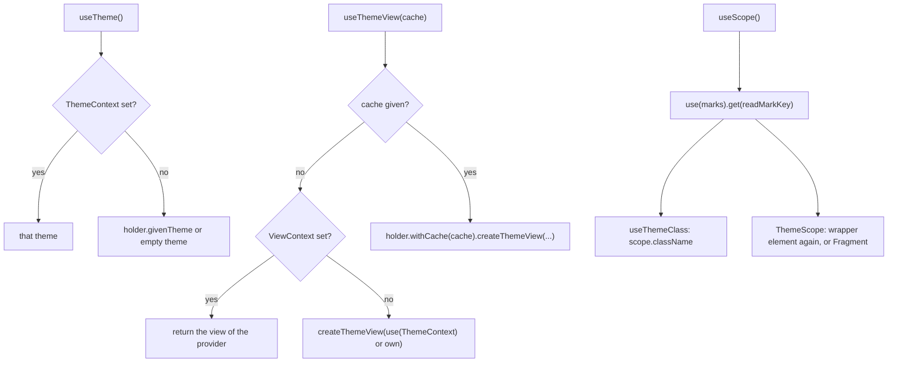

# ThemeValue.tsx

Build: client (`'use client'`).

## What it does

`createThemeValue(holder, contexts)` makes the readers of the theme for one style: `useTheme` (the real
theme), `useThemeView` (the view that function styles read), `useThemeClass` (the class of the nearest
nested wrapper) and `ThemeScope` (that wrapper again, around children). `readMarkKey` gives the key under
which a provider is marked. It re-exports `createThemeContexts` and `ThemeContexts` from `ProviderScope.tsx`.

## Why it exists

Every component that styles itself with a function, and every app component that reads the theme, needs the
same answer: the nearest provider's theme, else the base theme, else an empty theme. Keeping the readers in
one file keeps that rule in one place. `createStyle.ts` and `ThemeProvider.tsx` import it.

## The logic

## The data

`ThemeHolder<T>` is `Pick<Engine<T>, 'cache' | 'givenTheme' | 'createThemeView' | 'withCache'>`: the part of
an engine the readers need. The mark key is the cache prefix, or the `Cache` itself when it is not the
engine's own.

## What it guarantees

- The theme given as a base theme is read; a theme that a provider gave through `adoptTheme` is not, since it
  would outlive that provider.
- `useThemeView` reads `ThemeContext` with `use` and only when it must build a view, so a component that
  reads a view that was given renders again only when the view changes.
- `ThemeScope` with no nested provider renders its children in a Fragment.

## Decisions

- A provider of the server build sets `ViewContext` to `undefined`; the view is then made from the real theme.
- Under a `CacheProvider` the view is made by the engine over that cache, so references name that cache's
  variables.
- The contexts are shared by prefix (see `ProviderScope.tsx`), not made here.

## Limits

- `useTheme` below a server-build provider reads the theme the browser part of that provider puts in
  `ThemeContext`; it holds plain data only (what `plainTheme.ts` keeps).
