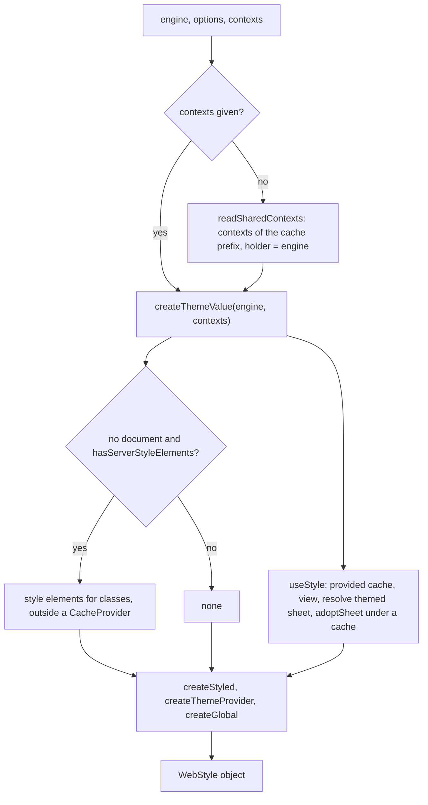

# createStyle.ts

Build: client. The server counterpart is `createStyle.server.ts`.

## What it does

`bindEngine(engine, options, contexts)` assembles the whole React styling of the client build over one
engine: `styled`, `StyleSheet`, `useStyle`, `useStyleValue` (`useStyleValue.ts`, over the engine's cache or the provided one), `apply`, `css`, `ThemeProvider`, `ThemeScope`, `useTheme`,
`useThemeClass`, `themeClass`, `when`, `whenScheme`, `keyframes`, `globalStyles`, `Global`, plus the
`engine` and its `cache`. `createStyle(theme, options)` makes an engine (or takes the one in `options`),
gives it the theme as base theme, and binds it.

## Why it exists

It is the one place that wires the pieces of the binding to an engine, so `createStyle` and the default
style (`defaultStyle.ts`) build the same thing. Every other file of the client build makes one piece
(`styled.ts`, `ThemeProvider.tsx`, `Global.ts`, `ThemeValue.tsx`); this one passes them the engine, the
contexts and the server-rendering choices.

## The logic

## The data

- `StyleOptions`: engine options plus `hasServerStyleElements` (default true).
- A themed sheet is resolved against the view in `useStyle`; an object sheet is its own entries.

## What it guarantees

- Every style of one prefix shares the same theme contexts (`readPrefixStyle`), so providers and readers of
  two styles with the same prefix agree.
- `useStyle` reads the provided cache and the view first for every sheet, so a component's hooks never change.
- Under a `CacheProvider` the entries of `useStyle` are adopted into that cache; `apply` makes its class in the
  cache of the entries (`findEntryCache`), else the engine's.
- Style elements are rendered only where there is no document, outside a cache provider, and when
  `hasServerStyleElements` is not false.
- `createStyle` sets the theme only when the engine has none (`engine.givenTheme === undefined`).

## Decisions

- A server render of the client build can send style elements, so the first HTML is styled whichever build
  rendered a component; the option turns it off for set-ups that extract the CSS into one element (comment
  on `ServerStyleOptions` in `types.ts`).
- `Global` chooses between style elements and the marker of its sets: elements outside a cache provider,
  the marker (with the prefix of that cache) otherwise.

## Limits

- `StyleSheet.create` with an object does not wait for a theme; a function sheet needs `useStyle`.
