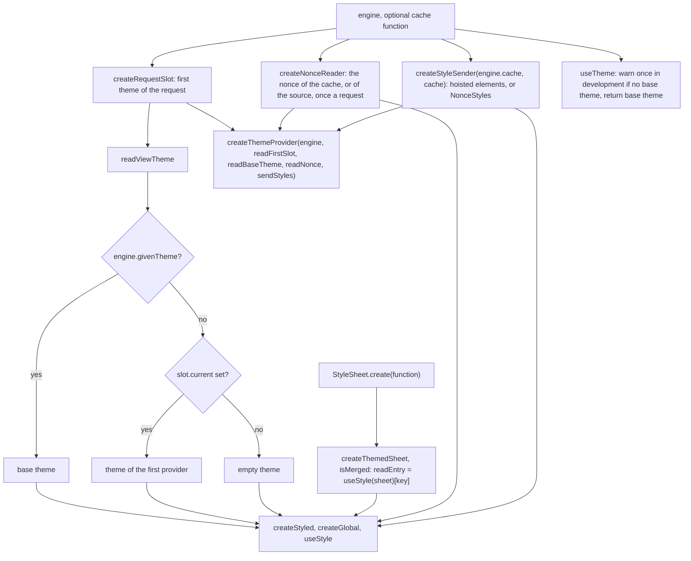

# createStyle.server.ts

Build: server (components build: no hook, no context). The client counterpart is `createStyle.ts`.

## What it does

`bindEngine(engine, cache?)` assembles the styling for server components over one engine: `styled`,
`StyleSheet`, `useStyle`, `withStyle`, `useStyleValue` (`useStyleValue.server.ts`: the first number, a setter that warns), `apply`, `css`, `ThemeProvider`, `useTheme` (also exported as `readTheme`), `withTheme`,
`themeClass`, `when`, `whenScheme`, `keyframes`, `globalStyles` and `Global`. `createStyle(theme, options)`
makes the engine, gives it the theme as base theme, and binds it. There is no `ThemeScope`,
`useThemeClass` or `ThemeContext` in this build.

## Why it exists

A server component reads no context, so the theme must come from somewhere else: the base theme the app
gave, else the theme of the first provider of the request. This file builds that reading (`readViewTheme`)
and passes it to the server `styled` and `Global`, and passes the request slot to the server `ThemeProvider`.
It also makes the reader of the nonce of a request (`createNonceReader`, `serverContext.ts`), with the
nonce of the cache as its fallback, and gives it to all three, so that every style element of a request
carries the nonce that a source registered with `setNonceSource` gave it. And it makes what the three
send their style texts with (`createStyleSender`, `inlineStyles.server.ts`): the `<style href precedence>`
elements of React, or, in a request with a nonce (from a source or the cache), `NonceStyles`, with the slot of the
request that keeps what that request has shown in place.
`defaultStyle.server.ts` and `index.server.ts` use it.

## The logic

## The data

The request slot is `{ current: DeepPartial<T> | undefined, isSet }`, made by `React.cache` in
`serverContext.ts`.

## What it guarantees

- `useTheme()` returns the base theme, the same in every render; it never reads a provider.
- With no base theme it returns an empty object, and warns once in development.
- An object sheet works with no theme; a themed sheet resolves against `engine.createThemeView(readViewTheme())`.
- `apply` and `css` use the engine's own cache; there is no `CacheProvider` in this build. `apply` given a
  handle throws the `TypeError` of `apply()`.
- A handle of a function sheet (`sheet.card`) given to a styled server component is the entry of this
  build's `useStyle`: the class a server component gets from `useStyle(sheet).card`. A handle, an entry
  or a class name passed to a client component as a prop crosses with no CSS and is unstyled there: a
  client component imports the sheet and is given a plain value that chooses the style
  (`sheetEntry.md`, which warns about what crossed).
- The handles of this build are made with `isMerged`: their key holds `null`. React reads every key of a
  prop for its messages of development, and a key that throws made the page fail on the development
  server. A plain element in a server component given a
  handle in `style` therefore writes nothing and raises no error; the types reject it, and `String(handle)`
  still throws.
- No hook is called; `serverGuard.test.ts` checks it for the files of this build.

## Decisions

- Tokens are references in the view either way, so only the shape of the theme is needed: the first provider's
  theme gives it when the app has no base theme (comment on `readViewTheme`).
- `cache` is a parameter so a test can give a function with the contract of `React.cache`.

## Limits

- What needs the values of the nearest provider is a client component, whose `useTheme()` reads them.
