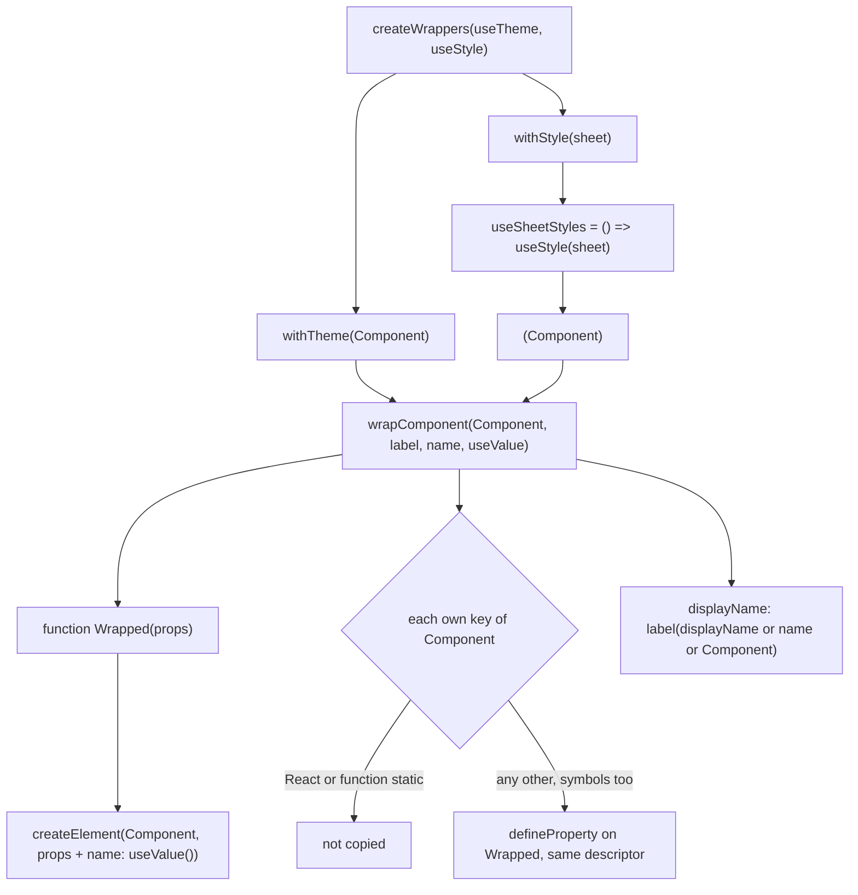

# createWrappers.ts

Build: both. The client build (`createStyle.ts`, `defaultStyle.ts`) and the server components build
(`createStyle.server.ts`, `defaultStyle.server.ts`) import it. It has no `'use client'`, calls no hook of
React and makes no context, so `serverGuard.test.ts` lets the server build reach it.
`packages/react-native/src/createWrappers.ts` is the same file in the React Native binding, which does not
depend on this package.

## What it does

`createWrappers(useTheme, useStyle)` returns `withTheme` and `withStyle` over the two functions of one style:

- `withTheme(Component)` is a function component that renders `Component` with every prop it is given and
  `theme` set to `useTheme()`.
- `withStyle(sheet)(Component)` is the same with `styles` set to `useStyle(sheet)`.

The call happens in the render of the wrapper, so the value is exactly what the hook gives in that place:
in the client build the nearest provider (and under a `CacheProvider` its cache's entries), in the server
build the base theme and the entries resolved against it, the plain functions of that build. The default
styles pass their own `useTheme` and `useStyle`, which bind the style only when called: wrapping a
component at module level leaves `configure` open.

## Why it exists

A class component cannot call a hook, and code that moves from a library with `withTheme` keeps the
wrapper. The two wrappers are thin: what they give is the hook's result, so there is one rule for the theme
and one for a sheet, and the wrappers cannot drift from them.

## The logic

## What it guarantees

- `theme` is the value of `useTheme()`, and `styles` the value of `useStyle(sheet)` (the same entry
  objects), in the same place: `createWrappers.test.tsx` (nested providers, object and function sheets),
  `createWrappers.ssr.test.tsx` (the server render of a client component), `createWrappers.server.test.tsx`
  (the server components build).
- The wrapper's value is set after the props it is given: a `theme` or `styles` passed anyway is replaced.
- Every other prop is passed on, `ref` among them: in React 19 `ref` is a prop of a function component, and
  `createElement` gives it to the instance of a class component or to the function component's own `ref`.
- The statics of `Component` that are not in `OWN_STATICS` are on the wrapper, with their descriptors:
  static fields and methods, symbols. Those React reads (`defaultProps`, `propTypes`, `contextType`,
  `getDerivedStateFromProps` and the rest), those of a function (`name`, `length`, `prototype`) and those of
  an object made by `memo` or `forwardRef` (`$$typeof`, `type`, `compare`, `render`) are not: the wrapped
  component keeps and reads its own, and a copied `prototype` would make React take the wrapper for a class.
- The display name is `withTheme(Name)` or `withStyle(Name)`, where `Name` is the component's `displayName`,
  else its function name, else `Component`.

## Decisions

- The hook is called in the body of `Wrapped`, a component, and `withStyle` names its closure
  `useSheetStyles`: the lint of the hooks sees a hook called where hooks are called.
- No `forwardRef` and no dependency for the statics: React 19 passes `ref` as a prop, which is the peer
  range of the binding, and the list of statics is the short one above. `styled` hoists none of
  the statics of a component it wraps (it sets its own), so there was no helper to share.
- The same file in the React Native binding, rather than a helper in the core: the wrapper needs
  `createElement` of React, and the core knows no framework.
- The types (`WrappedComponent`, `StyleWrapper`, `PropsTaking` in `types.ts`) follow the props of the
  component: `C` is inferred, its props must take the value at `theme` (or `styles`), and the wrapper's
  props are `ComponentPropsWithRef<C>` without that name.

## Limits

- An inline arrow component given straight to a wrapper gets no contextual type for its props (`theme`
  does not exist on them): annotate its props, or declare the component first.
- A static that a component gets at run time, after it was wrapped, is not on the wrapper.
