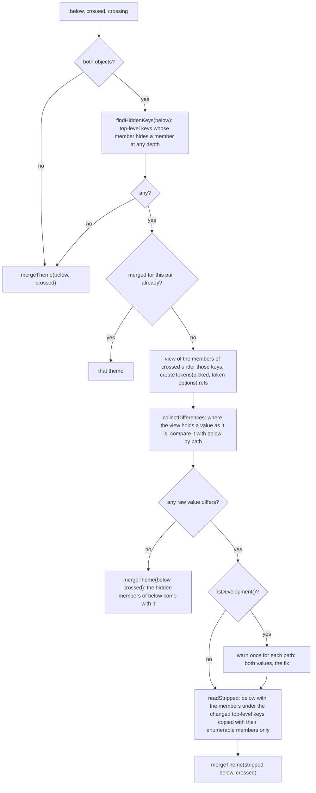

# crossedTheme.ts

Build: client, and the server render of client components (`ProviderScope.tsx` imports it; it needs no
React).

## What it does

`mergeCrossed(below, crossed, crossing)` merges a theme that crossed from a provider of the server build
(`crossed`, plain data) over a theme of the client build (`below`: the base theme of the engine, or the theme
of a provider above in the page). It is `mergeTheme`, except where `below` has hidden members (own members
that are not enumerable, or under a symbol) and a raw value of `crossed` differs from `below`: there the
member of `below` is taken with its enumerable members only, and in development the path is warned about
once.

## Why it exists

A design system puts helpers on its theme as hidden members: `breakpoints.up`, `down`, `between`, made with
`Object.defineProperty` as closures over the sizes. They cannot cross from a server component
(`plainTheme.ts` copies an object without them), so `crossed` never has them. `mergeTheme` keeps every own
member of `below` with its descriptor, so a client component below a provider of the server build reads the
helpers of `below`. That is right when the sizes are the same (the app registered the same theme on the
client, as `createStyle(theme)`) and wrong when they differ: the helper would answer from other sizes. This
file decides which (#81).

## What "raw" is

A raw value is one that the view of the theme holds as it is, not as a `var()` reference: what a class made
from the theme depends on. It is what `createTokens(...).refs` of the core keeps: every value under a path
whose mode is `raw` or `inline` (by default the top-level keys `breakpoints` and `components`, the `rawKeys`
option, and the `modes` option for any path), and every value that is not a string or a number (a boolean,
`null`). A token, a string or a number in `variable` or `reference` mode, is a variable: the class names the
variable, which the rule of the provider declares, so the theme object that holds it does not matter, and it
never counts. The token options are those of the engine of the client build (`CrossingHolder.tokenOptions`
in `ProviderScope.tsx`), whose classes are made from them. A value that `crossed` leaves `undefined` keeps
the one below and is not compared.

## The logic

## The data

- `Crossing`: `{ prefix, tokens, isBase }`. `prefix` starts the warning, `tokens` are the token options of the
  engine of the client build (undefined before a style of the prefix is loaded: the defaults of the core),
  `isBase` says whether `below` is the base theme of the client build or the theme of a provider above, which
  the warning names.
- A difference: `{ path, crossed, below }`, the dotted path from the top-level key (`breakpoints.md`).
- Four maps, kept weakly by the theme below: its hidden keys; its stripped copies, by the joined top-level
  keys; the merge of each pair of themes; and a `Set` of the prefix and path of each warning given.

## What it guarantees

- A `below` with no hidden member gives what `mergeTheme` gives: no comparison and no copy (the output of a
  theme with no hidden member is the one before #81).
- With the same raw values, a client component below a provider of the server build reads the helper of the
  base theme, built by the app's own code from the right sizes: the result of a client provider of the same
  theme.
- With a raw value that differs, the member of `below` under that top-level key has no hidden member at any
  depth, so no helper made from other values is read: `breakpoints.up` is `undefined` there. The other
  top-level members of `below`, and its own hidden members, are as they are.
- The same pair of objects gives the same theme every time, and a crossed theme of the same contents over the
  same `below` gives the theme that merge made (`mergeTheme`'s memo, over one stripped copy for each set of
  keys), so a reader that completes the theme in each render passes on one object.
- Production does the same, with no message: the comparison decides what the merge takes, so it runs in
  every build, for a `below` with hidden members only, once for each pair.

## Decisions

- The member stripped is the whole top-level member (all of `breakpoints`), not only the object that holds
  the value that differs: a helper on `breakpoints` can be made from `breakpoints.values.md`, and another
  object under it from the same sizes.
- The comparison is against `below`, the theme the merge takes the hidden members of, so a provider of the
  server build nested in one whose sizes it changes does not read the helpers of the one above; its warning
  names that theme and the fix of a client file.
- A raw value is found from the view rather than by reading the modes again here: the view is what the core
  makes for a class, so the two cannot disagree. Rejected: comparing every value (a token that a provider
  changes, the usual case, would drop the helpers and warn); warning without stripping (a helper made from
  other sizes would answer).
- Rejected: no comparison in production. The merge has to know whether the sizes are the same to keep the
  helper, so only the message is for development.

## Limits

- A token whose value is its own reference (`palette.primary: 'var(--umber-palette-primary)'`) is held as it
  is by the view too and is compared as a raw value; such a variable names itself and is invalid in CSS.
- Hidden members of the root of `below` are always kept: a helper on the theme itself made from the
  breakpoints still answers from the sizes of `below`.
- A list is replaced whole by a merge, so a helper hidden on a list (`breakpoints: ['600px']` with an `up`)
  never reaches a client component below a provider that gives that list, whatever its values.
- An object of `below` met again inside itself is kept as it is in the stripped copy, with its hidden
  members.
- A function under an enumerable key of `below` is not hidden: it is kept, as the warning of the server build
  says (a member that cannot cross keeps the value of the theme above).
