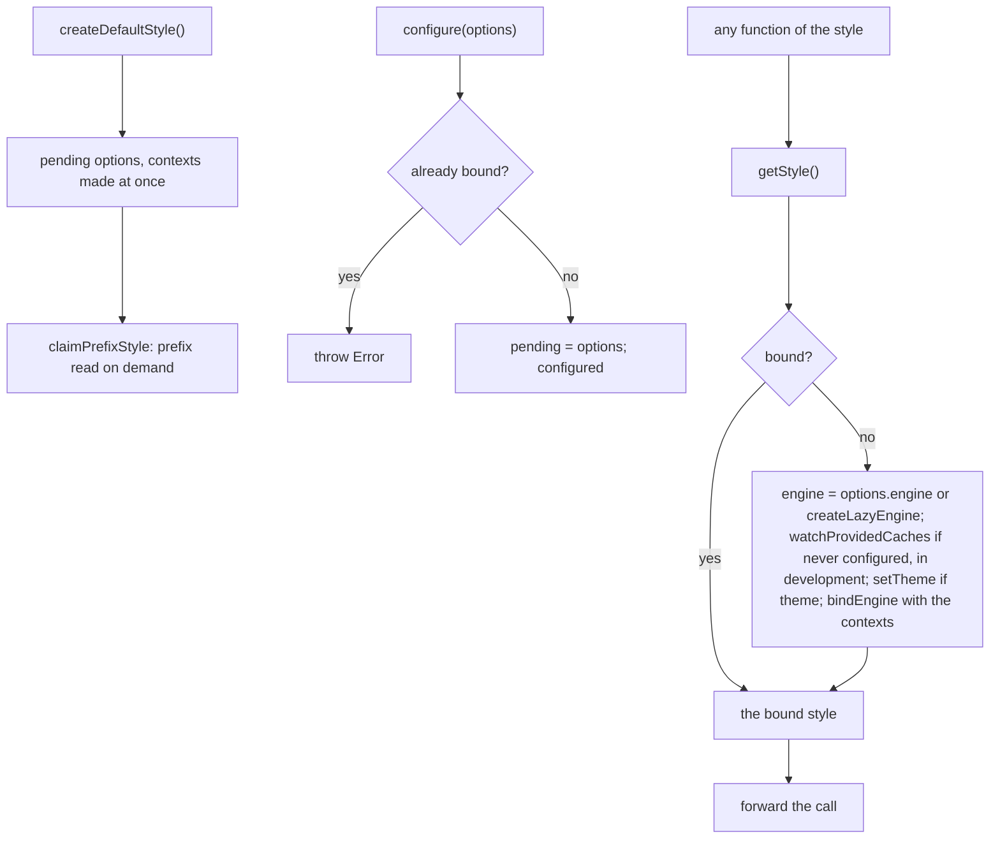

# defaultStyle.ts

Build: client. The server counterpart is `defaultStyle.server.ts`.

## What it does

`createDefaultStyle()` makes the default styling: `styled`, `StyleSheet`, `useStyle`, `useStyleValue`, `useTheme`,
`ThemeProvider`, `ThemeScope`, `useThemeClass`, `ThemeContext`, `apply`, `css`, `when`, `whenScheme`,
`themeClass`, `keyframes`, `globalStyles`, `Global`, plus `configure` and `getEngine`. Each is a thin function
that forwards to a style bound on first use.

## Why it exists

An app imports `styled` from the package before it can call `configure({ theme })`. So nothing may make the
engine at import time. This file keeps the options pending, makes the engine and binds it on the first call
that needs it, and refuses `configure` after that. `index.ts` calls it once through `readSharedState`.

## The logic

## The data

`DefaultStyleOptions`: engine options, `hasServerStyleElements`, and `theme` (the base theme). The prefix the
style will have is, in order: the bound cache's, the given engine's cache, `cache` option, `prefix` option,
else `'css'`.

## What it guarantees

- `configure` throws once the style was used (`'configure must be called before the default style is used.'`).
- Reading `styled.div` does not bind the style; only giving it styles does, so `configure` stays open
  (comment in the file).
- An object sheet and a `css()` entry are deferred, so a module may create them before `configure`.
- `keyframes` and `globalStyles` need no engine and are the core's.
- The contexts exist before the engine, so `ThemeContext` can be exported, and a server-build provider of the
  claimed prefix may render before the style is first used.

- In development, a style that `configure` was never called on warns once when a component of it renders
  under a `CacheProvider` whose cache has another prefix (`watchProvidedCaches.ts`): the sign of a
  `configure` call that did not run. It changes nothing else.

## Decisions

- `claimPrefixStyle` gets a `holder` whose `givenTheme` reads the bound engine, else the pending theme, else the
  pending engine's, so the browser part of a server provider merges over the right base theme.

## Limits

- A function sheet (`StyleSheet.create(fn)`) is made at once through `getStyle()`, so it binds the style.
