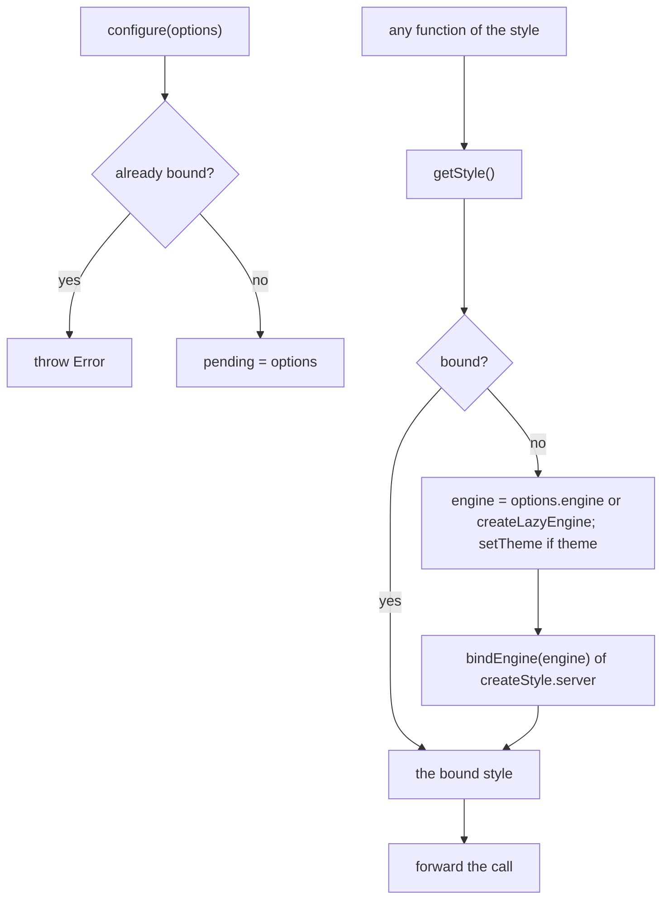

# defaultStyle.server.ts

Build: server (components build: no hook, no context). The client counterpart is `defaultStyle.ts`.

## What it does

`createDefaultStyle()` makes the default styling for server components: `styled`, `StyleSheet`, `useStyle`, `withStyle`, `useStyleValue`,
`useTheme`, `readTheme` (the same function), `withTheme`, `ThemeProvider`, `apply`, `css`, `when`, `whenScheme`,
`themeClass`, `keyframes`, `globalStyles`, `Global`, plus `configure` and `getEngine`. Each forwards to a
style bound on first use.

## Why it exists

The same reason as the client file: a module imports `styled` before the app calls `configure`, so the engine
must be made on first use. This build has no contexts to claim, so it is the client file without
`ThemeScope`, `useThemeClass`, `ThemeContext` and the prefix claim. `index.server.ts` calls it once through
`readSharedState`.

## The logic

## The data

`DefaultStyleOptions` (`types.ts`): engine options, `hasServerStyleElements` (ignored here: this build always
sends style elements), and `theme`.

## What it guarantees

- `configure` throws once the style was used.
- `styled.div` read alone does not bind the style.
- An object sheet and a `css()` entry are deferred; `keyframes` and `globalStyles` need no engine.
- No hook or context: `serverGuard.test.ts` lists this file among those the server build reaches.

## Decisions

- It repeats the structure of `defaultStyle.ts` instead of sharing it. The code does not record a reason.

## Limits

- It does not claim a prefix, so a client-build style of the same prefix makes its own contexts.
