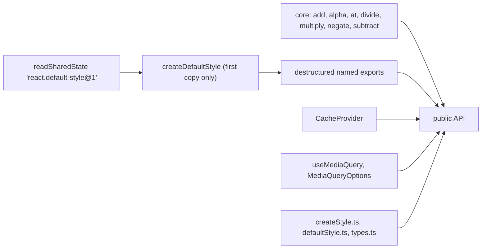

# index.ts

Build: client. The server build's entry is `index.server.ts`.

## What it does

It is the public entry of `@umber-style/react`. It makes the default style once, exports its members by name
(`styled`, `StyleSheet`, `useStyle`, `useTheme`, `ThemeProvider`, `ThemeScope`, `useThemeClass`,
`ThemeContext`, `apply`, `css`, `themeClass`, `when`, `whenScheme`, `keyframes`, `globalStyles`, `Global`,
`configure`, `getEngine`), and re-exports the math helpers of the core, `CacheProvider`, `useMediaQuery`,
`createStyle`, `defaultStyle` and the types.

## Why it exists

The package needs one place that fixes the public names. `umber-style/react` and `@umber-style/styled`
re-export from here. The default style is held in `readSharedState` so that two copies of the binding in one
program use the same one and read each other's providers and caches.

## The logic

## What it guarantees

- Importing the package makes no engine: the default style binds on first use (see `defaultStyle.md`).
- No browser global is touched at module top level.
- Names match the other bindings (`styled`, `ThemeProvider`, `useTheme`, `StyleSheet`, `useStyle`, `apply`).

## Decisions

- The shared-state key carries a version, `react.default-style@1`, so a change of its shape can use a new key.
- The server build uses another key, `react.server-default-style@1`, so the two builds do not share a style.

## Limits

- `index.test.ts` checks the exports. Anything not in this file or the `export *` lines is not public.
