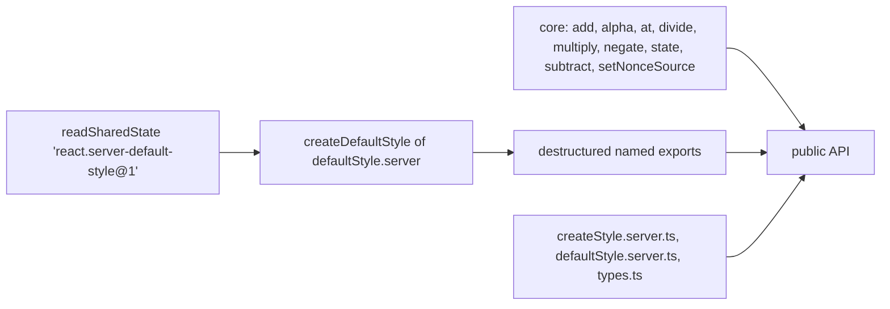

# index.server.ts

Build: server (the entry under the `react-server` condition: no hook, no context).

## What it does

It is the public entry of `@umber-style/react` for server components. It makes the server default style once
and exports its members: `configure`, `getEngine`, `styled`, `StyleSheet`, `useStyle`, `withStyle`, `useStyleValue`, `useTheme`, `withTheme`,
`readTheme`, `ThemeProvider`, `apply`, `css`, `themeClass`, `when`, `whenScheme`, `keyframes`,
`globalStyles`, `Global`. It re-exports the core's math helpers, `createStyle.server` and `defaultStyle.server`,
and the types.

## Why it exists

A server component must not import anything that calls a hook or makes a context. This entry reaches only the
files of the server build, so the bundle of server components holds none of the client build. Compared with
`index.ts`, it has `readTheme` and lacks `ThemeScope`, `useThemeClass`, `ThemeContext`, `CacheProvider` and
`useMediaQuery`.

## The logic

## What it guarantees

- The files it reaches are exactly `Global.server.ts`, `ThemeProvider.server.ts`, `createStyle.server.ts`,
  `createWrappers.ts`, `defaultStyle.server.ts`, `index.server.ts`, `inlineStyles.server.ts`, `plainTheme.ts`,
  `serverContext.ts`, `styleElements.ts`, `styled.server.ts`, `styledParts.ts`, `types.ts` and
  `useStyleValue.server.ts`; it reaches three client components only by reference, `GlobalRelease.ts`,
  `NonceStyles.tsx` and `ProviderScope.tsx` (`serverGuard.test.ts`).
- It calls no hook, makes no context and imports nothing of the client build.
- `setNonceSource` is the core's: the style elements of this build carry the nonce that the source it registers gives each request (`serverContext.ts`).

## Decisions

- `readTheme` is the same function as `useTheme`: a server component calls it without the name of a hook.
- The shared-state key is not the client's, so one program may hold both builds.

## Limits

- No `CacheProvider` here: the server build has no context to carry a cache.
