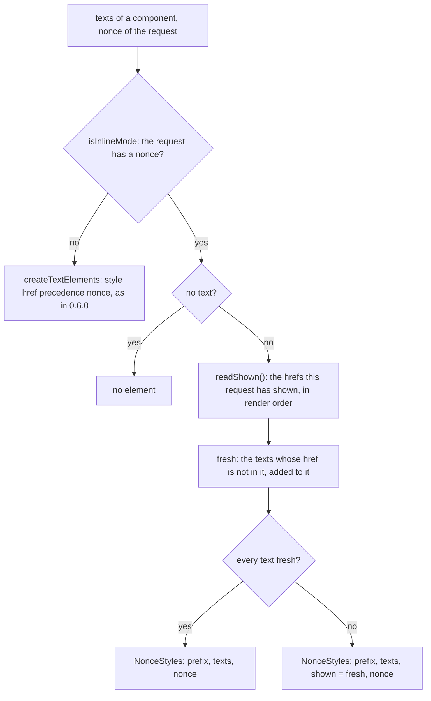

# inlineStyles.server.ts

Build: server (components build: no hook, no context). Its browser part is `NonceStyles.tsx`.

## What it does

`createStyleSender(engineCache, cache?)` makes the function that every component of the server build
(`styled`, `Global`, a root `ThemeProvider`) sends its style texts with, in the current request.
`isInlineMode(nonce)` says which of two forms a request gets:

- Outside inline mode, the `<style href precedence nonce>` elements of 0.6.0 (`createTextElements`), which
  React hoists into the head and sends once for each `href`.
- In inline mode (the request has a nonce: the answer of the source registered with `setNonceSource`, else
  the cache's, fixed with `createCache({ nonce })` or `configure({ nonce })`), one `NonceStyles` element with every text of the component, in
  order, the nonce of the request, and `shown`: the `href` of the texts that no component of the request
  showed before. `shown` is left out when the component shows all of its texts.

## Why it exists

Next.js 16.4.6 gives React the nonce of a request as a string, which React takes as the script nonce only,
so the one `<style data-precedence>` element that React's server render merges the hoisted elements into
has no `nonce`, whatever the props carry, and a strict policy refuses it. And each request of a client-side
navigation has a nonce of its own, which the policy of the document does not allow, so the elements React
inserts for it are refused too. A `<style>` with no `precedence` is not hoisted and keeps its `nonce`, and
the browser can write into the head with the document's nonce: `NonceStyles` does both, from the texts
this file sends it. `createStyle.server.ts` makes one sender for each engine; `styled.server.ts`,
`Global.server.ts` and `ThemeProvider.server.ts` call it, and `ThemeProvider.server.ts` reads
`isInlineMode` for the description it hands `ProviderScope`.

## The logic

## The data

- `StyleSender`: `(texts, nonce) => ReactElement[]`.
- The slot of a request (`cache(() => new Set())`, `React.cache` unless a test gives a function with the
  same contract): the `href` of every text a `NonceStyles` of the request showed in place. It is per
  sender, so per engine, and lives as long as the request.
- The props of `NonceStyles`: `{ prefix, texts, shown?, nonce }`, plain data that crosses to a client
  component. `texts` is always the whole list, so that the browser writes all of it into the head in order.

## What it guarantees

- The mode is decided for each request by its nonce alone, whatever its origin: a request with no nonce at
  all gets exactly the elements of 0.6.0 (`nonceSource.server.test.tsx` compares the trees).
- In inline mode no `<style href precedence>` element is sent, so React merges nothing into an element with
  no nonce.
- A text is shown in place once in a request, in the order the request renders its components: a later
  component that needs a class already shown sends it in `texts` but not in `shown`.
- `NonceStyles` is imported from a `'use client'` file, so in a bundler of server components the import is
  a reference to it; it is never run on the server (`vitest.clientReferences.ts` mocks it the same way, and
  `serverGuard.test.ts` lists it among the references of the server build).
- It calls no hook.

## Decisions

- A cache nonce is a nonce. A framework that gives React the nonce as a string (the script nonce only) makes
  the merged element nonce-less whether the nonce came from a source or was fixed on the cache, so an app
  that fixes one nonce on its cache and registers no source needs the in-place form as much as one with a
  source. A request is in inline mode for the nonce it has, from either, and so is one whose source answers
  `undefined` where the cache has a nonce (`serverContext.ts`). Only a request with no nonce at all keeps
  0.6.0's form.
- The whole list goes to every `NonceStyles`, not only what it shows: the payload of server components held
  the text of every element in 0.6.0 as well, and the browser needs it when the element that showed a text
  is gone before hydration.

## Limits

- "Once in a request" is the order in which the request renders its components. A text first shown inside
  a `Suspense` fallback is not shown again by the content that replaces it: when React's script swaps the
  content in before the boundary hydrates, the class has no rule until it does (seen on the fixture's
  `/csp-inplace`, 22 to 30 ms on the prototype). Under a `StyleRegistry` (`@umber-style/react/next`)
  `NonceStyles` shows nothing in place: the registry writes each text once, before the piece of the stream
  that first uses it, so the fallback's piece carries the rule.
- The slot needs a request to scope to (`React.cache` in the server build of React); outside a render every
  call makes a new slot, and every `NonceStyles` shows all of its texts.
