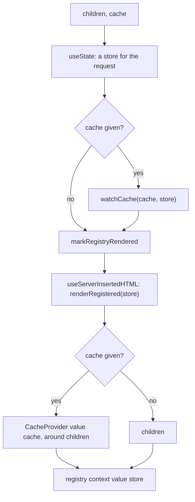

# next.tsx

Build: client (`'use client'`). The entry `@umber-style/react/next`, and the one file of the package that
imports `next` (an optional peer dependency).

## What it does

`StyleRegistry` is the style registry of the Next.js App Router. An app adds it once, around the page,
in its root layout (a server component may render it: it is a client component). For each request it
makes a store (`styleRegistry.ts`), gives it to the components below through a context, and writes what
they registered with `useServerInsertedHTML`, which Next.js calls on every flush of the stream.

- The components of the server build hand it their texts through `NonceStyles` (in a request with a
  nonce: without one React hoists their elements as before).
- The client components of each style hand it the texts of their classes, of the theme and of the global
  rules (`createStyle.ts`); under `cache` they write into that cache, which the registry watches.

## Why it exists

So that an app on the App Router writes no registry of its own, and so that the styles of server
components under a nonce are never in place among the elements of the page (see `styleRegistry.md`).

## The logic

## The data

- `StyleRegistryProps`: `children`, and `cache`, an `UmberCache` made for the request.

## What it guarantees

- One store for each request (the state of the component), so two requests never share what they wrote.
- No nonce prop: each text carries the nonce the engine already had for it (the request's, from a nonce
  source or the cache).
- In the browser it renders the same tree as on the server, and the callback of the hook is never called.

## Decisions

- `cache` is optional. With it the client components below use that cache, as under the registry an app
  writes by hand, and the output is the same as that registry's, with `data-umber-registry` on the element
  (`next.test.tsx`). Without it they keep the engine's own cache, which lives as long as the server, so its
  new rules cannot be what a request sends: the registry takes the texts of each class they render.
- The hook is imported from `next/navigation`, its public module; no other file imports `next`, so an app
  that does not use this entry never loads it.

## Limits

- Run on Next.js 16.4.6 (Turbopack, production build and development server). Partial prerendering and
  the edge runtime were not run.
- A client-side navigation renders no HTML: the hook does nothing there. The rules of a navigation are
  written by the browser (`NonceStyles`, the engine's cache).
