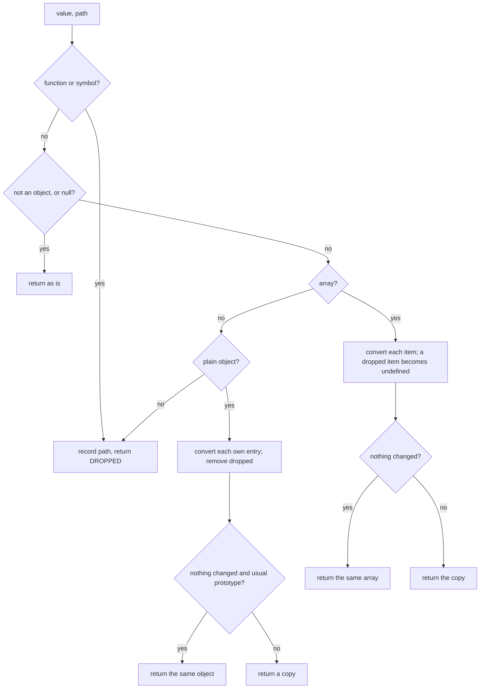

# plainTheme.ts

Build: server (only `ThemeProvider.server.ts` imports it; it needs no React).

## What it does

`toPlainTheme(theme)` returns `{ theme, dropped }`: the part of a theme that can cross from a server
component to a client component, and the dotted paths of what was left out. It keeps strings, numbers,
booleans, `null`, `undefined`, arrays and plain objects, deeply. It drops functions, symbols and objects
that are not plain (class instances, `Date`, `Map`).

## Why it exists

A server component hands props to a client component as data that must be serialisable. A theme can hold a
function or an instance. Without this step the whole payload would fail, or send something that cannot be
read in the browser. `ThemeProvider.server.ts` calls it and warns once, in development, when `dropped` is not
empty.

## The logic

## The data

`PlainTheme`: `{ theme: object, dropped: readonly string[] }`. A path is `palette.primary` or `breakpoints.1`;
the root path is `''`. A whole theme that cannot cross gives `{}`.

## What it guarantees

- A theme that is already plain comes back as the same object (no copy).
- A dropped member of an array keeps its place, as `undefined`.
- An object with no prototype is copied, as only an object with `Object.prototype` crosses as it is.
- The result for a theme object is made once (`WeakMap`), so a payload that names one theme in several
  places holds one object.
- Only own enumerable members are read.

## Decisions

- Drop and report, not throw: the app keeps rendering, with a development warning from the caller.

## Limits

- A cycle in the theme is not detected.
