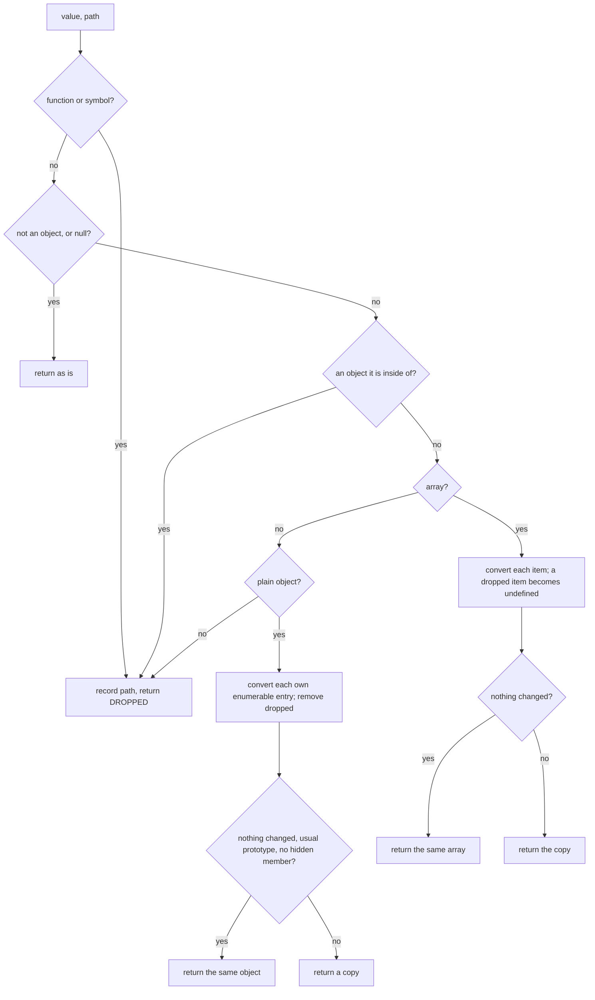

# plainTheme.ts

Build: server (only `ThemeProvider.server.ts` imports it; it needs no React).

## What it does

`toPlainTheme(theme)` returns `{ theme, dropped }`: the part of a theme that can cross from a server
component to a client component, and the dotted paths of what was left out. It keeps strings, numbers,
booleans, `null`, `undefined`, arrays and plain objects, deeply. It drops functions, symbols and objects
that are not plain (class instances, `Date`, `Map`), and a member that refers back to an object it is
inside of (a cycle). An object with hidden members (own members that are not enumerable, or whose key is a
symbol: the helpers a design system puts on `breakpoints` with `Object.defineProperty`) is copied with its
enumerable members, and the hidden ones are not listed in `dropped` (#81).

## Why it exists

A server component hands props to a client component as data that must be serialisable. A theme can hold a
function or an instance. Without this step the whole payload would fail, or send something that cannot be
read in the browser. `ThemeProvider.server.ts` calls it for everything a provider sends that it did not make
itself (the given theme, the base theme, the token options) and warns once, in development, when `dropped`
of a given theme is not empty.

## The logic

The objects on the way down from the theme to `value` are in a `Set` (`ancestors`): each object is added
before its members are converted and taken out after, so an object that two members share is converted in
both places, and only an object met again inside itself is a cycle.

## The data

`PlainTheme`: `{ theme: object, dropped: readonly string[] }`. A path is `palette.primary` or `breakpoints.1`;
the root path is `''`. A whole theme that cannot cross gives `{}`.

## What it guarantees

- A theme that is already plain comes back as the same object (no copy).
- A dropped member of an array keeps its place, as `undefined`.
- An object with no prototype is copied, as only an object with `Object.prototype` crosses as it is.
- The result for a theme object is made once (`WeakMap`), so a payload that names one theme in several
  places holds one object.
- Only own enumerable members are read. A plain object with any other own member (`Reflect.ownKeys` is
  longer than its enumerable string keys) is copied, so the original, with its hidden members, never
  crosses: React's development build prints "Only plain objects can be passed to Client Components" for
  such an object, and its production build sends the enumerable members only. A theme with no hidden
  member gives what it gave before (the same object where nothing is dropped).
- It returns for a theme with a cycle: the member that closes the cycle is left out and its path listed
  (`leaves out a member that refers back to an object it is inside of, and returns`). A theme with no cycle
  gives what it gave before: an object shared by two members is not a cycle (`keeps an object that two
  members share, which is not a cycle`).

## Decisions

- Drop and report, not throw: the app keeps rendering, with a development warning from the caller. A cycle
  is treated like any other member that cannot cross.
- The guard is a set of the objects on the current path, not of every object seen: a theme that shares one
  object in two places crosses as it did.
- A hidden member is left out without a word: it is not part of the theme's data, the client build reads it
  from the base theme of its own engine where the raw values are the same (`crossedTheme.md`). A function
  under an enumerable key is still reported, by the caller's warning. Rejected: reporting hidden members
  too, which would warn for every theme of a design system that does it on purpose.

## Limits

- Hidden members of an array (a member besides its items and `length`) are not checked: the array crosses
  as it is, and React sends its items only.
- The recursion follows the depth of a theme: a theme nested deeper than the stack allows throws a
  `RangeError`.
- What is left out of a cycle depends on where the walk enters it: the member that closes the cycle, met
  last, is the one dropped.
