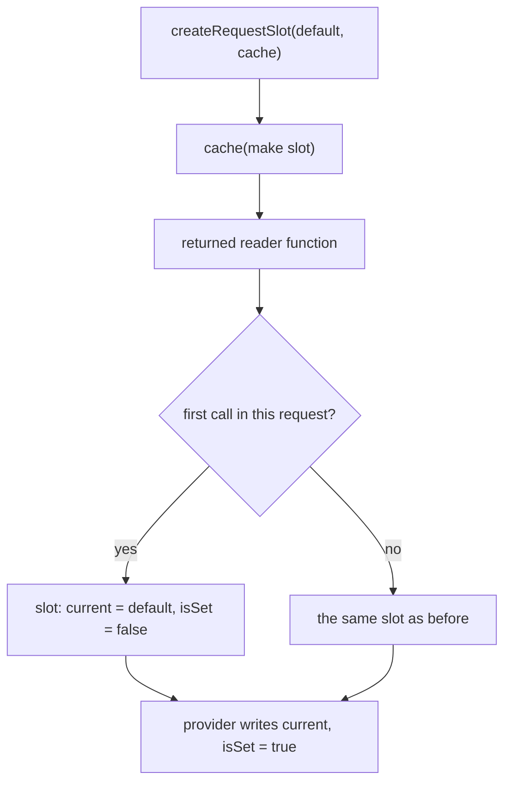

# serverContext.ts

Build: server (imported by `createStyle.server.ts`).

## What it does

`createRequestSlot(defaultValue, cache?)` returns a function that gives the slot of the current request: a
mutable `{ current, isSet }` that starts as `{ current: defaultValue, isSet: false }`. The slot is made with
`React.cache`, or with a function of the same contract (`CacheFunction`).

## Why it exists

A server component has no context, but the server `ThemeProvider` needs to know whether it is the first
provider of this request, and what theme that one had. `React.cache` keeps one value for the length of a
request, so the slot is private to a request and never shared between two. `createStyle.server.ts` makes one
slot for each engine.

## The logic

## The data

`ServerSlot<T>`: `current: T`, `isSet: boolean`. `isSet` tells whether a provider has written `current` in this
request.

## What it guarantees

- Never shared between requests, so nothing written there depends on the order of requests.
- The reader may be called many times in a request and returns the same object.

## Decisions

- The `cache` parameter exists so a test can give a function with the same contract; the default is
  `React.cache` (`serverContext.server.test.tsx` gives it a stand-in that keeps one value for each request).

## Limits

- It works only where `React.cache` has a request to scope to (the server build of React).
