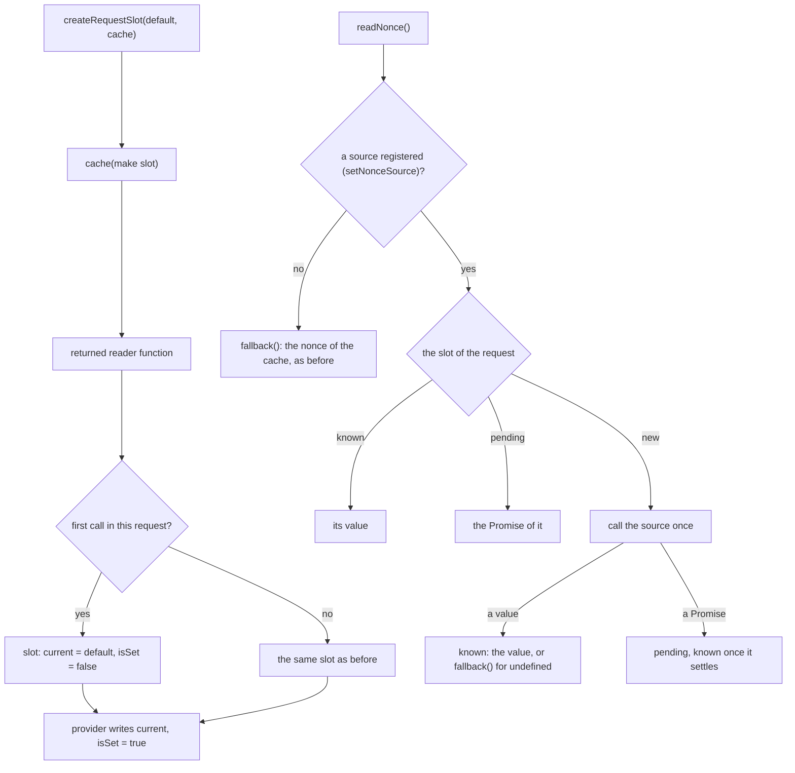

# serverContext.ts

Build: server (imported by `createStyle.server.ts`).

## What it does

`createRequestSlot(defaultValue, cache?)` returns a function that gives the slot of the current request: a
mutable `{ current, isSet }` that starts as `{ current: defaultValue, isSet: false }`. The slot is made with
`React.cache`, or with a function of the same contract (`CacheFunction`). `createNonceReader(fallback,
cache?)` returns the function that gives the nonce of the current request for the style elements of the
server build, and `withNonce(nonce, render)` renders with it, at once or once its Promise settles.

## Why it exists

A server component has no context, but the server `ThemeProvider` needs to know whether it is the first
provider of this request, and what theme that one had. `React.cache` keeps one value for the length of a
request, so the slot is private to a request and never shared between two. `createStyle.server.ts` makes one
slot for each engine.

## The logic

## The data

`ServerSlot<T>`: `current: T`, `isSet: boolean`. `isSet` tells whether a provider has written `current` in this
request.

`NonceSlot`: `known` (`{ value }`, once the source answered) or `pending` (its Promise, before). One for each
request, made by `cache` (`React.cache`, which a render of server components scopes to its request: in
`react.react-server` it is kept by the dispatcher of the render, `ReactSharedInternals.A.getCacheForType`,
one cache for each request; the React documentation of `cache`, react.dev/reference/react/cache, says it is
for server components and is invalidated for each server request).

## What it guarantees

- Never shared between requests, so nothing written there depends on the order of requests.
- The reader may be called many times in a request and returns the same object.
- With no source registered the nonce is the cache's, read as before: nothing is kept and nothing waits.
- With a source, it is called once in each request. Every component that asks before a Promise it returned
  has settled gets that one Promise and waits for it (it returns a Promise of its element, the way an async
  server component does); every one that asks after gets the value at once, so nothing waits once the
  nonce is known. A source that answers `undefined` gives the nonce of the cache.

## Decisions

- **A Promise of the element, not `use()`.** `use` is allowed in server components (react.dev/reference/react/use
  says to prefer `async` and `await` there), but it re-renders the component when the Promise settles; a
  component that returns a Promise of its element is an async server component, which a render awaits as
  any other, and which the test helper `resolveTree` renders too. Either way, only the components that
  render before the source has answered wait.
- The `cache` parameter exists so a test can give a function with the same contract; the default is
  `React.cache` (`serverContext.server.test.tsx` gives it a stand-in that keeps one value for each request).

## Limits

- It works only where `React.cache` has a request to scope to (the server build of React).
