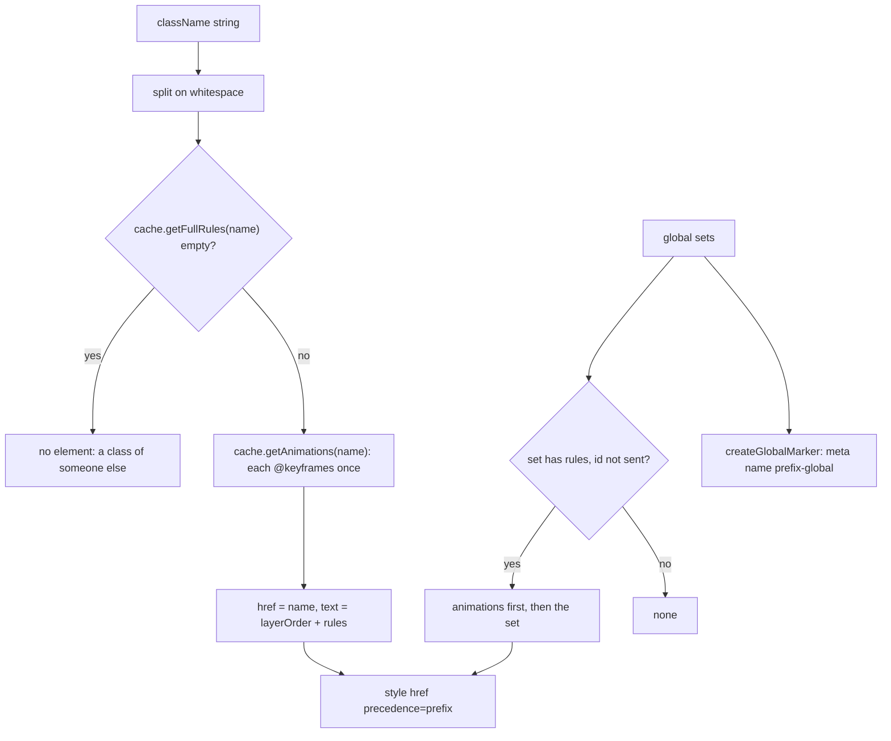

# styleElements.ts

Build: both. The server build uses it for every style it sends; the client build uses it for a server render
of a client component (no document) and for global rules.

## What it does

It turns what a cache wrote into React elements that React 19 hoists: `<style href precedence>` for classes
(`createStyleElements`, `collectStyleTexts` as data), for global rules (`createGlobalElements`), and two
`<meta>` elements: the marker that names global sets (`createGlobalMarkerElements`) and the stamp of the
cache options (`createStampElement`).

## Why it exists

In a server render the style of a class must be sent with the element, and React must send it once however
many elements name it (the `href`). The same text is also sent as data to a client component
(`StyleText`), which `ThemeProvider.server.ts` and `ProviderScope.tsx` use. `Global.ts`, `Global.server.ts`,
`createStyle.ts`, `styled.ts`, `styled.server.ts` and `ThemeProvider.server.ts` import it.

## The logic

## The data

- `StyleText`: `{ href, text }`. A class element is `{ href: name, text: layerOrder + rules }`; an animation is
  `{ href: animationName, text: keyframes rule }`.
- Precedence of every element is `cache.prefix`.

## What it guarantees

- Each element starts with the layer order statement, so it is right on its own (declaring a layer again does
  not change the order); none without layers.
- An animation is sent once for the call, and before the class that uses it. It is outside every layer, so it
  has no order statement.
- A class with no rules in the cache gets no element.
- A theme class comes with every variable it has, used or not.
- The options of the cache go in a `<meta name="<prefix>-options">`, not a style element, since a server
  render merges style elements of one precedence and keeps the attributes of none.

## Decisions

- The marker for global rules replaces style elements under a cache provider, so the CSS extracted for a page
  holds its sets and another page's does not.

## Limits

- `collectStyleTexts` sends an animation only once for each call; across calls React's `href` dedupes it.
