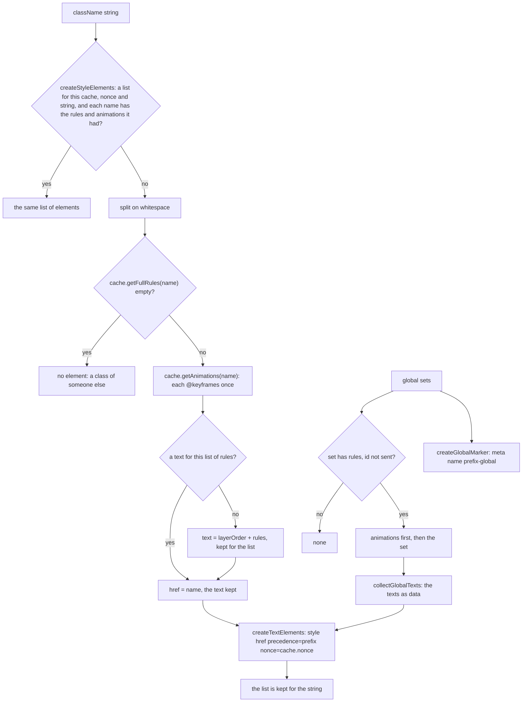

# styleElements.ts

Build: both. The server build uses it for every style it sends; the client build uses it for a server render
of a client component (no document) and for global rules.

## What it does

It turns what a cache wrote into React elements that React 19 hoists: `<style href precedence>` for classes
(`createStyleElements`, `collectStyleTexts` as data), for global rules (`createGlobalElements`,
`collectGlobalTexts` as data), for any list of texts (`createTextElements`), and two
`<meta>` elements: the marker that names global sets (`createGlobalMarkerElements`) and the stamp of the
cache options (`createStampElement`). It also keeps what a render makes again every time: the text of
the element of a class (`collectStyleTexts`), the list of elements of a class string (`createStyleElements`),
and the sets of the global styles of `Global` (`readGlobalSets`).

## Why it exists

In a server render the style of a class must be sent with the element, and React must send it once however
many elements name it (the `href`). The same text is also sent as data to a client component
(`StyleText`), which `ThemeProvider.server.ts` and `ProviderScope.tsx` use, and which the server build sends to
`NonceStyles` in a request with a nonce, from a nonce source or the cache (`inlineStyles.server.ts`, which also makes the
hoisted elements of the other requests with `createTextElements`). Only `createStyleElements` (the client build of
`styled` and `ThemeProvider`) keeps its list: the server build asks for texts and makes its elements from them, with
the nonce of the request, and keeps none. `Global.ts`, `Global.server.ts`,
`createStyle.ts`, `styled.ts`, `styled.server.ts`, `ThemeProvider.server.ts` and `inlineStyles.server.ts` import it.

## The logic

## The data

- `classTexts`: a `WeakMap` from the list of rules that `cache.getFullRules` gave for a class to the text of
  its element. The cache gives the same list while it holds the class (the rules it wrote for a class; the
  full rules of a theme class or a root theme until the `@property` rules change), so a render after the
  first takes the text, and the text goes when the cache lets the list go: a held class let go, or a new
  list of full rules. Its size is that of the texts of the classes the cache holds.
- `elementLists`: a `WeakMap` from a cache to a map by nonce to a map by class string to what a render of it made:
  the names, the list of full rules and the list of animation names each had (`getFullRules`, `getAnimations`)
  and the elements. A render takes the elements while every name still has the same list of rules (the same
  object, or both empty: the cache gives a new empty list for a name it has nothing for) and the same
  animations. A class let go and written again has a new list of rules, a class that the cache did not have and
  has now has rules where it had none, so each makes a new list; the elements of the old list are not changed.
  A nonce of its own has its own list. A level of the map holds at most `ELEMENT_LIST_LIMIT` (10,000) entries,
  then is emptied; the cache holds them weakly, so they go with it. The list is one array that every render of
  the string gets: nothing here or in `styled.ts` changes it.
- `readGlobalSets(engine, styles, view)` keeps the sets of `engine.resolveGlobal(styles, view)` in three
  `WeakMap`s, by the engine, the styles (an object, a handle, a function or a list) and the view: they go
  with any of them. Styles that are no object or function are resolved each time.

- `StyleText`: `{ href, text }`. A class element is `{ href: name, text: layerOrder + rules }`; an animation is
  `{ href: animationName, text: keyframes rule }`.
- Precedence of every element is `cache.prefix`; its `nonce` is `cache.nonce` (none when the cache has none),
  unless the server build gives the nonce of the request (`createTextElements(cache, texts, nonce)`), which a
  source registered with `setNonceSource` answers.

## What it guarantees

- Each element starts with the layer order statement, so it is right on its own (declaring a layer again does
  not change the order); none without layers.
- An animation is sent once for the call, and before the class that uses it. It is outside every layer, so it
  has no order statement.
- A class with no rules in the cache gets no element.
- A theme class comes with every variable it has, used or not.
- The options of the cache go in a `<meta name="<prefix>-options">`, not a style element, since a server
  render merges style elements of one precedence and keeps the attributes of none.

## Decisions

- The marker for global rules replaces style elements under a cache provider, so the CSS extracted for a page
  holds its sets and another page's does not.
- The nonce is a prop of each element, not something written into the text. React's server render merges the
  elements of one precedence into one `<style>` and writes on it the style nonce of the render
  (`nonce: { style }`), keeping the rules of an element only when its `nonce` prop is that nonce
  (`nonce.ssr.test.tsx`); in the browser React sets the prop on the element it makes. So the cache and the
  render must be given the same nonce.

## Limits

- `readGlobalSets` takes the styles of `Global` as a function of the theme alone, as the memo of the
  client component does: a function that reads something else (a value of the module that changes between
  requests) gets the sets of the first render with that view. A function made in the render is a new key
  each time, and is called each time, as before.

- `collectStyleTexts` sends an animation only once for each call; across calls React's `href` dedupes it (in
  inline mode, the set of what the request has shown, in `inlineStyles.server.ts`).
- The nonce is the cache's, fixed when the engine made it, unless the server components build has a source
  registered (`setNonceSource`): a classic server render of the client build that renders many requests with
  one engine sends the same nonce in each. A nonce for each request needs a cache for each request (a `CacheProvider`,
  under which no style element is rendered here, and the registry writes its own).
